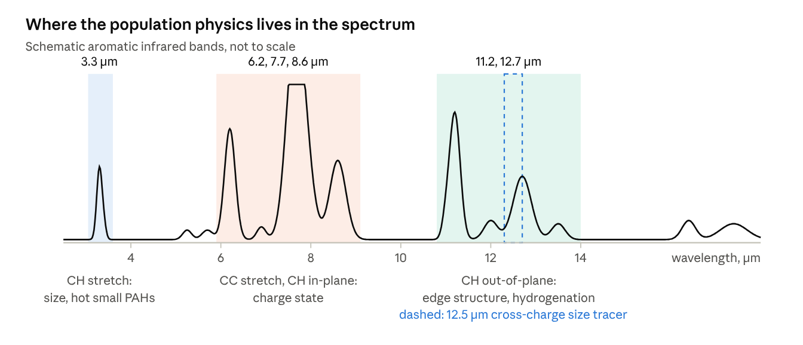
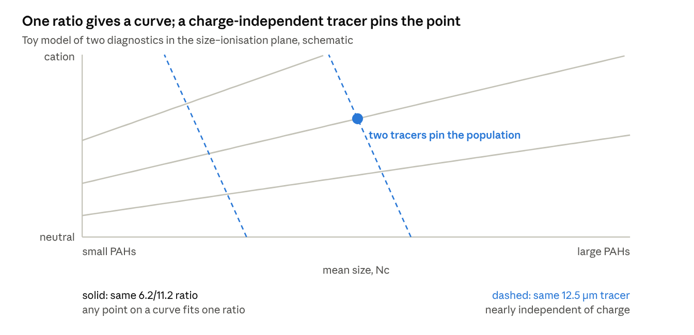
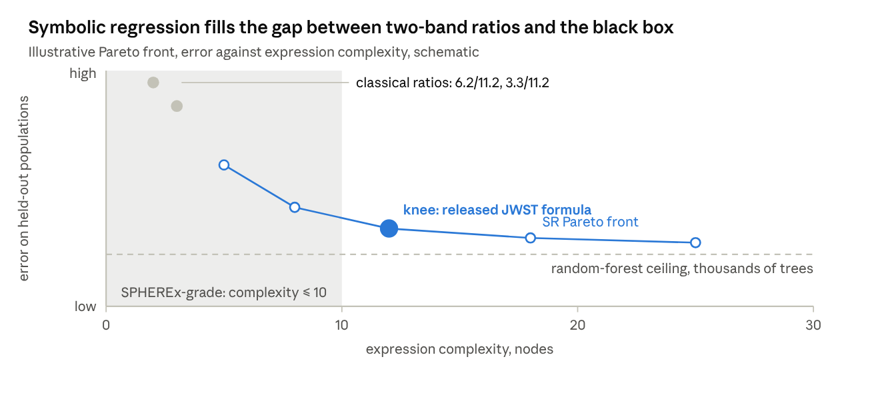
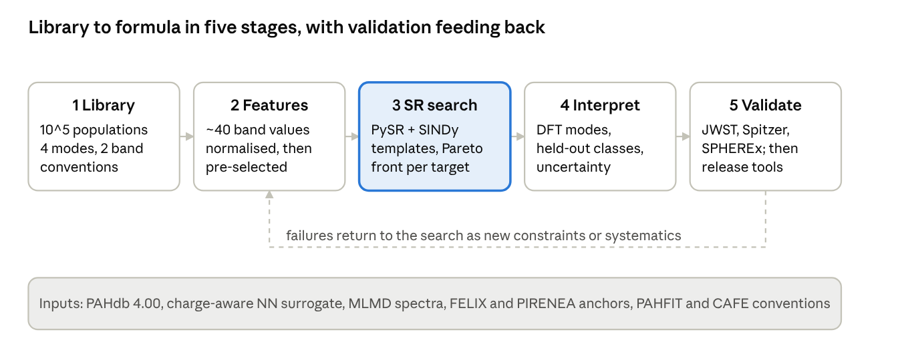
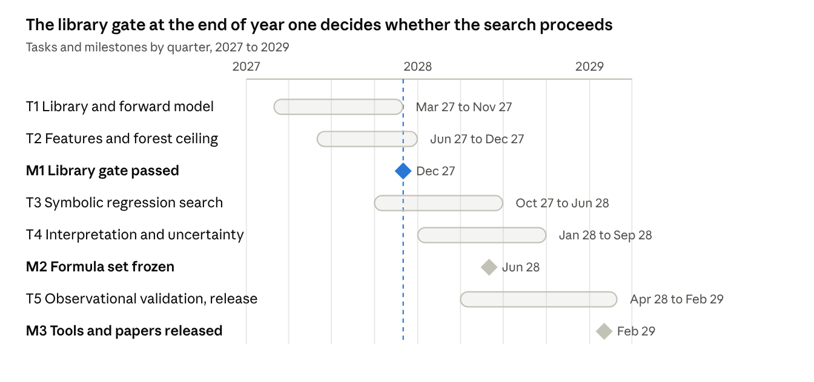

# Interpretable PAH Diagnostics by Symbolic Regression

Proposal draft: background and objectives · Oct 17, 2026 · @이재준

## Background

### 1. The diagnostic problem

The aromatic infrared bands (AIBs) are the brightest spectral signature of carbon in the universe, carrying up to 20% of the infrared luminosity of star-forming galaxies, yet they are read with a handful of band ratios whose physical meaning was established thirty years ago on a few dozen laboratory and computed spectra. Every PAH-based inference in the literature (ionisation state, molecular size, aliphatic content, radiation-field hardness, even star-formation rate and metallicity dependence in galaxies) rests on these ratios.

**How bands are measured.** Band strengths come from one of three families of decomposition: spline continuum subtraction with direct integration (the "spline" method), Drude- or Gaussian-profile fitting with a dust continuum (PAHFIT, CAFE, and the JWST-era extensions), or template fitting against the NASA Ames PAHdb basis (pyPAHdb). The three disagree systematically: the spline method yields 7.7 µm fluxes 2–3 times lower than PAHFIT because the profile fit assigns the plateau underneath to the band. Any diagnostic therefore carries a method-dependent offset before physics is considered.

**The classical ratios and what they are claimed to trace**

| Ratio | Claimed tracer | Basis | Typical dynamic range |
| --- | --- | --- | --- |
| 6.2/11.2, 7.7/11.2, 8.6/11.2 | Ionisation fraction: CC stretches at 6–9 µm are strong in cations, the 11.2 µm CH out-of-plane bend is strong in neutrals | Matrix-isolation and DFT intensities; Spitzer surveys of PDRs | Factor 3–5 across a PDR |
| 3.3/11.2 | Size: 3.3 µm CH stretch emitted preferentially by small, hot molecules | Thermal emission models; the Orion Bar shows a 40% drop from dissociation front to H II region | Factor 2–3 |
| 11.2/12.7 (and 11.2/13.5) | Edge structure: solo versus duo/trio/quartet CH, hence compactness and dehydrogenation | DFT mode assignments | Factor 2 |
| 3.4/3.3 | Aliphatic to aromatic fraction | Methyl and superhydrogenated spectra | 0.05–0.4 |
| 6.2/7.7, 7.7 peak position | Nitrogen substitution, band class A/B/C | Peak-position taxonomy (Peeters classes) | Discrete classes |
| 11.0/11.2 | Cation fraction from the out-of-plane region alone | DFT: cation 11.0 µm band | 0.05–0.3 |

The three shaded regions are where the classical ratios take their numerators and denominators; the dashed 12.5 µm window is the cross-charge size tracer identified by the 2026 random-forest study that no classical ratio uses.

**Evidence that the ratios carry real information.** The ionisation ratios correlate with the ionisation parameter G0 sqrt(T)/ne across Galactic PDRs over two orders of magnitude; the 3.3/11.2 ratio tracks modelled PAH size across the Orion Bar and across protoplanetary disks of different stellar temperature; and the ratios shift coherently with the A/B/C profile classes from H II regions to post-AGB stars. So the AIBs do encode population physics, and the ratios extract some of it.

**Why that is no longer enough.** JWST now resolves band profiles, sub-features and spatial gradients at a level where a two-band ratio throws away most of the information, and SPHEREx delivers the 3.3 µm band alone for the whole sky, where no established diagnostic exists. The community needs diagnostics that use the full spectrum where it is available and that are honest about what one band can and cannot tell when it is not.

### 2. Why classical ratios fail

Each ratio was defined as if one variable changed at a time. In real spectra, size, charge, radiation field, hydrogenation and structure vary together, and the ratios are entangled in ways that have only recently been quantified.

**Size and charge are not separable with two bands.** Ionisation raises the 6–9 µm bands and lowers the 11.2 µm band; increasing size at fixed internal energy *also* lowers the short-wavelength bands relative to the long. A spectrum with a low 6.2/11.2 ratio is therefore either neutral or large or both. The full-spectrum random-forest study of Feb 2026 made the point sharply: the bands that trace size in neutral PAHs are not the bands that trace size in cations, so a single size diagnostic applied across a PDR, where charge changes with depth, is biased by construction. It also found that the 12.5 µm region is the only cross-charge size tracer in the 3–20 µm range, a band that no classical ratio uses.

**Radiation field and size are degenerate in emission.** Emission band ratios depend on the internal energy after photon absorption, which is set by the photon energy divided by the heat capacity, that is by the radiation-field hardness divided by molecular size. A harder field on larger molecules looks like a softer field on smaller ones. The 3.3/11.2 ratio, the standard size tracer, is degenerate with G0 and the stellar effective temperature unless both are independently constrained.

**Hydrogenation and structure move the 11–14 µm bands.** The 11.2/12.7 ratio is read as solo-to-duo CH, hence compactness. But superhydrogenation, pentagon defects and dehydrogenation all redistribute intensity in the same region. JWST spectra of the Orion Bar show the 11.2 µm profile switching class and a 11.25 µm shoulder appearing deep in the PDR, attributed to clusters or very small grains, neither of which the ratio was designed to capture.

**The bands are blends.** JWST resolves at least a dozen sub-features under the 7.7 and 11.2 µm complexes, with different spatial behaviour. Integrating them into one band and dividing by another averages over components that respond to different physics. The 7.7 µm complex alone contains the 7.6 and 7.8 µm components whose ratio defines the A/B class.

**Measurement systematics are comparable to the signal.** The factor 2–3 disagreement between spline and profile-fit fluxes for 7.7 µm, extinction corrections through the 9.7 µm silicate feature that affect 8.6 and 11.2 µm differently, ice features at 3 and 6 µm in embedded sources, and continuum subtraction under the 3.3 µm band in SPHEREx's low-resolution data all enter the classical ratios at the tens-of-percent level, the same size as the physical trends being measured.

**What a usable diagnostic must do.** It must use more than two bands, combine them in a way that cancels the known degeneracies rather than averaging over them, be computable from the band strengths that PAHFIT- and CAFE-style fits already produce so that it drops into existing pipelines, carry an uncertainty, and be simple enough that an astronomer can see which bands drive the answer. Black-box classifiers meet the first two requirements and fail the last three; the classical ratios meet the last three and fail the first two.

In a toy model where the 6.2/11.2 ratio rises with ionisation and falls with size, a measured ratio only confines the population to a curve. A second quantity that depends on size but barely on charge intersects that curve at one point, which is what a multi-band formula has to find.

### 3. What has changed: the data now exist

Until about 2023 a better diagnostic was not derivable because the training set did not exist: a few hundred computed spectra, tens of laboratory spectra, and Spitzer spectra that blended the bands. Three developments remove that limit.

**Large, labelled spectral libraries.** The [NASA Ames PAHdb](https://astrochemistry.org/pahdb) version 4.00 holds 10,749 computed species with known size, charge, structure and composition, and its sensitivity analysis shows the library now fits the full 6–15 µm range. The charge-aware neural-network surrogate of [He, Mai & Wang (A&A 708, A335, 2026)](https://www.aanda.org/10.1051/0004-6361/202659248), trained on 12,599 species across four charge states, generates PAHdb-quality spectra for any of a million enumerated structures in milliseconds, so the library can be made as large and as evenly sampled in size, charge and structure as a regression needs. The MLMD approach of [Mai et al. (MNRAS 541, 2025)](https://export.arxiv.org/abs/2503.05120v1) adds temperature-dependent anharmonic spectra for 1,704 species up to 216 carbons, so the dependence of band ratios on internal energy can be learned rather than assumed from a cascade model. Every spectrum in these libraries comes with the ground-truth label (number of carbons, charge, hydrogen adjacency classes, heteroatoms) that a diagnostic is meant to recover.

**Proof that the information is in the spectrum.** [Wang (2026)](https://www.arxiv.org/abs/2602.12531) trained a random forest on 23,653 spectra and recovered twelve size-by-charge classes with F1 near 0.96 from the full 2.75–20 µm spectrum. The forest's feature importances show where the information lives: the 12.5 µm region as a cross-charge size tracer, the 6–9 µm CC region for charge, and different size-sensitive bands for neutrals and cations. The result is a map of which spectral regions a formula should combine, but the forest itself is thousands of trees and cannot be written on a slide or applied to a PAHFIT output.

**Observations that can test a formula, not just motivate it.** JWST provides spectra where several physical parameters are constrained independently of the PAHs: in the Orion Bar the radiation field, density and depth are known from PDR modelling, so a size or charge diagnostic can be checked against an expectation rather than against another ratio. NGC 7023, the Horsehead, reflection nebulae and protoplanetary disks around stars of known effective temperature extend the range of G0 and photon hardness. SPHEREx gives the 3.3 µm band for the whole Galactic plane, where the diagnostic question is inverted: what is the best estimate of population properties from one band plus the Planck dust and radio continuum context that SPHEREx pixels come with? Finally, GOTHAM's radio detections in TMC-1 give, for one source, the only structure-specific abundance measurements, which any size-distribution formula should be consistent with when extrapolated to small species.

**Taken together.** A labelled library of order 10^5 spectra with controlled variation in each physical parameter, a demonstration that the parameters are recoverable, and observations with external constraints form exactly the three ingredients a regression needs: training data, an upper bound on achievable accuracy, and an independent test. None of them existed together before 2026.

### 4. Symbolic regression as the method

Symbolic regression (SR) searches the space of closed-form mathematical expressions for the one that best fits data at a given complexity, instead of fitting coefficients inside a fixed functional form. The output is a formula, so the "trained model" is written in the same language as the classical ratios and can be inspected, differentiated, propagated through error analysis and typed into a paper. For a diagnostic that other astronomers must adopt, that is the decisive property: a random forest with F1 of 0.96 is a result, a three-term formula with R² of 0.9 is a tool.

**How it works.** Modern SR engines treat an expression as a tree of operators (+, −, ×, ÷, log, powers) and variables, and search that space with evolutionary algorithms, sparse regression or neural guidance. [PySR](https://arxiv.org/abs/2305.01582) (Cranmer 2023), the de facto standard in astrophysics, runs a multi-population evolutionary search with an evolve–simplify–optimise loop, fits the numerical constants of each candidate by gradient methods, and returns a Pareto front of expressions trading accuracy against complexity rather than a single answer. Its 2025 template-expression feature lets the user fix part of the functional form and search only the rest, which is how physical constraints (a ratio must be dimensionless, a size tracer must be monotonic in Nc) are embedded. SINDy (sparse identification of nonlinear dynamics) is the alternative when the candidate terms can be enumerated in advance: it regresses the target onto a library of basis functions with an L1 penalty, which is fast and well suited to a fixed set of band strengths. AI Feynman and its successors add dimensional analysis and symmetry detection to prune the search. Recent extensions ([DeepPySR](https://arxiv.org/abs/2607.08150), 2026) address exactly the issues a spectral problem raises: many correlated input variables, principled Pareto-front selection, and hierarchical composition of sub-formulas.

**Track record in astronomy.** SR has recovered an analytic estimator for dark-matter halo overdensity from the Quijote simulations that beats hand-derived formulas (Cranmer et al. 2020); produced interpretable gravitational-wave population models from LIGO/Virgo catalogues; rediscovered empirical scaling relations from survey data; and, in the SR-plus-neural-network mode, extracted closed-form laws from graph neural networks trained on N-body data. In each case the formula was not only as accurate as the black-box model it replaced but exposed which inputs mattered and how, which is the information a PAH diagnostic needs to convey.

**Why it fits the PAH problem specifically**

- The inputs are already a small set of physically meaningful scalars (band strengths, peak positions, widths from PAHFIT or CAFE), so the search space is tractable and the result is directly applicable to archival measurements.
- The targets are continuous physical labels (mean Nc, ionisation fraction, hydrogen-adjacency fractions) available for every library spectrum, with no need for human annotation.
- Degeneracies are the problem to be solved, and SR handles them by construction: a formula that uses a cross-charge size tracer like the 12.5 µm region and divides out the charge-sensitive bands is a candidate the search can find and the user can understand, whereas the same information inside a forest is invisible.
- Known physics can be imposed as template constraints (monotonicity, limiting behaviour at small and large Nc, invariance to overall flux scaling), so the result stays physically sensible outside the training range.
- Pareto-front output gives the community a choice: a two-term formula for SPHEREx-quality data and a six-term formula for JWST-quality data, derived from the same search and consistent with each other.

**Known limitations and how they are handled.** SR scales badly with the number of input variables (dozens of sub-features from JWST would need pre-selection from the random-forest importances); it can overfit noise-free synthetic libraries unless realistic noise, continuum and extinction are injected during training; and it finds correlations rather than mechanisms, so every discovered formula has to be checked against the DFT mode assignments and against observations with independent constraints. Each of these is a design step in the objectives below rather than a reason the method cannot work.

The search returns the whole front, not one formula; the knee is where added terms stop buying accuracy, and the shaded low-complexity region is where the single-band SPHEREx diagnostics must live.

### 5. The gap

No one has yet run a systematic search for interpretable PAH diagnostics on the libraries that now exist. The classical ratios were chosen by physical intuition on small samples and have never been re-optimised; the 2026 random-forest work demonstrates that the information is recoverable but leaves it inside a black box; the PAHdb template-fitting route returns a full decomposition but inherits the library's selection biases and is too heavy to apply to millions of SPHEREx pixels. Between the two-band ratio and the full decomposition there is an unoccupied middle: formulas of three to six terms, derived from 10^5 labelled spectra, validated on JWST sources with independent constraints, and delivered as functions that take PAHFIT or CAFE output. This proposal occupies that middle.

Three features make the timing right rather than merely possible. The charge-aware surrogate makes the training library arbitrarily large and evenly sampled, removing the small-sample bias that shaped the classical ratios. JWST has produced the first spectra where several population parameters are externally constrained, so a formula can be tested rather than only motivated. And SPHEREx has created a concrete demand: a single-band diagnostic for the 3.3 µm feature across the whole sky, which does not exist and which only a method that can quantify what one band cannot tell is equipped to supply.

## Research objectives

**Primary objective.** Derive, validate and release a set of compact, interpretable formulas that recover the size, charge and hydrogenation properties of an emitting PAH population from measured band strengths, with stated uncertainties, superseding the classical band ratios for JWST- and SPHEREx-era data.

**Specific objectives**

| # | Objective | Approach in one line | Deliverable |
| --- | --- | --- | --- |
| O1 | Build a regression-ready library | Generate \~10^5 emission spectra with the charge-aware surrogate and MLMD temperature dependence, sampled evenly in Nc, charge, hydrogen adjacency and radiation field; inject realistic noise, continuum, extinction and the spline-versus-PAHFIT measurement choice; reduce every spectrum to the band-strength vector that PAHFIT and CAFE report | Public library with labels and both measurement conventions |
| O2 | Discover candidate diagnostics | Run PySR and SINDy on the band-strength vectors against each physical label, with template constraints for dimensionlessness, monotonicity and flux-scale invariance; use random-forest importances to pre-select inputs | Pareto front of formulas per target; a two-term SPHEREx formula and a multi-term JWST formula for each |
| O3 | Explain and test them physically | Trace each formula's terms to DFT mode assignments; check behaviour on held-out structure classes (heteroatoms, pentagons, clusters) the search never saw | A mode-level interpretation of every released formula and documented failure modes |
| O4 | Validate on observations with independent constraints | Apply to PDRs4All Orion Bar, NGC 7023, the Horsehead and disks of known stellar temperature; compare recovered size and charge gradients with PDR-model expectations and with full PAHdb decompositions; apply the single-band formula to SPHEREx Galactic-plane maps | Validation paper; SPHEREx 3.3 µm population map with error bars |
| O5 | Release as community tools | Package formulas as functions in PAHFIT, CAFE and pyPAHdb post-processing, with uncertainty propagation | Software release and documentation adopted by at least one JWST programme |

**Scope.** Two years, one postdoc and one student, computational only; it draws on public libraries and public JWST and SPHEREx data and requires no new laboratory or telescope time. It is also the first and most self-contained direction of the larger agentic PAH programme, and its library and formulas feed that programme's unmixing and inverse-inference work.

## Required data

The project uses three kinds of data: a synthetic training library that the project generates, laboratory spectra that anchor the library, and observations with external constraints that test the formulas. All inputs are public; the only new data product is the library itself.

### D1. Synthetic training library (generated in-project)

**Single-molecule spectra.** The base set is the PAHdb 4.00 computational library (10,749 species, harmonic, scaled). It is extended in two ways. The charge-aware NN surrogate of He, Mai & Wang (2026) generates harmonic spectra for structures enumerated to fill gaps in the PAHdb sampling: the target is at least 2,000 species per decade of Nc from 20 to 200, with anion, neutral, cation and dication for each, and with controlled variation in hydrogen adjacency (solo, duo, trio, quartet fractions spanning the compact-to-irregular range), in hydrogenation state (fully dehydrogenated edges through +4 H superhydrogenation), and in defects (one or two pentagons, vinylidene edges). The MLMD approach of Mai et al. (2025) supplies anharmonic, temperature-dependent spectra at 300, 600, 900 and 1200 K for a subset of about 2,000 species covering the same ranges, used to learn the temperature dependence of each band rather than assume it. Total: of order 40,000 single-molecule spectra at the harmonic level, 8,000 at the anharmonic level.

**Emission model.** Each molecule is converted to an emission spectrum by a photon-cascade model with the exciting photon energy drawn from the 5–13.6 eV range and the stellar spectrum of a star with Teff from 4,000 to 40,000 K, so that radiation-field hardness is an explicit, labelled variable. Band widths follow the MLMD temperature series where available and a Nc-dependent empirical width otherwise. Two cascade implementations (the PAHdb standard and a stochastic-heating model) are run on a subset to quantify model dependence.

**Population spectra.** The regression targets are properties of populations, not molecules, so populations are built by drawing a size distribution (log-normal in Nc with mean 30–120 and width 0.1–0.6 dex), an ionisation fraction as a function of Nc (parametrised by G0·sqrt(T)/ne from 10^2 to 10^6), a hydrogenation state distribution, and a structure mix (compact fraction 0.3–1.0). Of order 100,000 populations are drawn with a Latin-hypercube design over these parameters so that no two parameters are correlated in the training set. Every population carries its labels: mean and width of Nc, mass-weighted ionisation fraction, mean solo/duo/trio fractions, aliphatic fraction, mean hydrogenation, radiation-field hardness.

**Instrument and measurement forward model.** Each population spectrum is passed through four observing modes: JWST NIRSpec G395H plus MIRI MRS (resolving power from the actual channel-dependent curves, 1–3% flux calibration systematics, pixel noise at S/N 20–300), Spitzer IRS low- and high-resolution, SPHEREx (102 band passes between 0.75 and 5 µm with R of 35 to 130 and a 6.2" pixel), and an idealised noise-free mode. A dust continuum (modified blackbody plus a hot component), extinction through a Galactic-centre-type silicate profile with AK from 0 to 3, and water and CO2 ice bands at 3.0 and 4.27 µm for a subset are added before measurement. Band strengths are then measured with both conventions in use: PAHFIT-type Drude decomposition (the JWST-era PAHFIT and CAFE releases) and spline-continuum integration. The final feature vector per population per mode is roughly 40 numbers: strengths, peak positions and widths of the 3.3, 3.4, 5.25, 5.7, 6.0, 6.2, 6.9, 7.6, 7.8, 8.3, 8.6, 10.6, 11.0, 11.2, 11.25, 12.0, 12.7, 13.5, 14.2, 16.4 and 17.4 µm components where the mode covers them.

**Volume.** About 100,000 populations × 4 modes × 2 conventions ≈ 800,000 feature vectors with labels, plus the underlying 10^5 spectra at full resolution. Of order 1 TB, stored as HDF5 with a versioned schema.

### D2. Laboratory anchors (public)

- PAHdb experimental library (\~100 matrix-isolation spectra) for the scaling-factor check on neutrals.
- Gas-phase cation IR spectra from FELIX and FELion (coronene, dicoronylene, diindenoperylene, methylated pyrenes, indenyl and fluorenyl ions) and from PIRENEA, used to quantify the surrogate-versus-experiment offset in band position and intensity as a function of Nc; this offset becomes an injected systematic in D1.
- Where available, temperature-series measurements of band widths to validate the MLMD width model.

### D3. Observational test sets (public archives)

| Source set | Programme and archive | Why it tests the formulas | External constraint used |
| --- | --- | --- | --- |
| Orion Bar | PDRs4All, JWST ERS 1288, MAST; template spectra for five zones and the full NIRSpec and MIRI MRS mosaics | The reference PDR with the strongest known gradients in size and charge | G0, density and depth from the PDRs4All PDR models; H2 and ionised-gas lines in the same cubes |
| NGC 7023, Horsehead, NGC 2023 | JWST GO programmes (NGC 7023 and Horsehead cubes public; Horsehead GO 1192), MAST | Softer fields and lower G0 than Orion; well-studied Spitzer references | Meudon PDR model fits; known stellar types |
| Protoplanetary disks | MINDS GTO 1282 and JDISCS MIRI MRS spectra, MAST | Known central-star Teff from 4,000 to 10,000 K breaks the size versus hardness degeneracy | Stellar Teff and luminosity |
| Nearby galaxies | PHANGS-JWST MIRI imaging and MRS pointings; GOALS MIRI spectra | Tests whether the formula is stable when PDRs are unresolved | Metallicity, Hα, dust mass |
| Galactic plane | SPHEREx all-sky Quick Release and Data Release 1 spectral cubes, IRSA | The single-band application; several million sight lines | Planck dust radiance and temperature, SPHEREx Brackett-α, radio continuum |
| Spitzer legacy | IRS spectra from CASSIS and the SINGS and C2D programmes | Checks the formula against the band-class system and 20 years of published ratios | Published classes and physical parameters |
| TMC-1 | GOTHAM and QUIJOTE column densities, published | Only structure-specific abundances; small-size end of any size distribution | Measured column densities of specific molecules |

### D4. Auxiliary data

- PDR model grids (Meudon, KOSMA-tau) to translate G0, density and depth into expected ionisation parameter at each JWST pixel.
- Stellar atmosphere models (ATLAS9, PHOENIX) for the exciting spectra in the emission model.
- Extinction curves (Gordon et al. JWST-era curves) and ice optical constants for the forward model.
- PAHFIT, CAFE and pyPAHdb source code for the measurement conventions and for the comparison decompositions.

### Data principles

Every feature vector in D1 records the random seed, surrogate version, cascade implementation, observing mode and measurement convention that produced it, so any discovered formula can be regenerated. The library is released with the paper under an open licence and deposited alongside PAHdb and on Zenodo.

## Method

The method is a five-stage pipeline in which the symbolic-regression search sits in the middle and both ends are anchored to physics: the library is built from quantum chemistry and the formulas are tested on observations with external constraints. Failures at the validation stage return to the search as new constraints.

Stages 1 and 2 turn quantum-chemical spectra into the band-strength vectors astronomers measure; stage 3 searches for formulas; stages 4 and 5 interpret and test them, and anything that fails returns to stage 3 as a new constraint.

### M1. Library construction (stage 1)

The library is built as described under D1. Three design choices matter for the regression and are fixed here.

- *Decorrelated sampling.* A Latin-hypercube design over the population parameters (size mean and width, ionisation parameter, hydrogenation, structure mix, radiation hardness, extinction, continuum) ensures that correlations the search finds are in the spectra, not in the sampling. A second, smaller library is sampled from astrophysically realistic priors (PDR-model-like joint distributions) to test formulas under the correlations nature actually imposes.
- *Systematics as variables.* The surrogate-versus-experiment offsets measured from D2, the cascade-model dependence, and the two band-measurement conventions are included as labelled nuisance variables, so a formula can be required to be insensitive to them or its sensitivity can be reported.
- *Held-out structure classes.* Heteroatom-substituted, pentagon-containing and clustered species are excluded from the main training library and kept as an out-of-distribution test set for stage 4.

### M2. Feature extraction and pre-selection (stage 2)

For each observing mode and convention, the measured band quantities are normalised to remove overall flux scale (each strength divided by the sum of all PAH band strengths, or by the 11.2 µm strength as the classical convention), positions expressed as offsets from nominal, and widths in km/s-equivalent. This produces about 40 scale-free features per spectrum. Because SR cost grows steeply with input dimension, inputs are pre-selected per target: a gradient-boosted or random-forest model is trained on the full feature set, permutation importances are computed, and the top 8–12 features plus any the physics requires (for example the 12.5 µm region as the known cross-charge size tracer) are passed to the search. The forest also sets the ceiling: the best accuracy achievable from these features with no interpretability constraint, against which every formula is scored.

### M3. Symbolic regression search (stage 3)

**Engines.** PySR for the open search and SINDy for the enumerated-basis search, run on the same inputs so that agreement between methods is itself a robustness check.

**Targets.** Separate searches for each population label: log mean Nc, size-distribution width, mass-weighted ionisation fraction, solo-fraction and duo-plus-trio fraction, aliphatic fraction, mean hydrogenation offset, and radiation hardness. A joint search for the size and ionisation pair uses PySR's multi-output mode, since the two are the main degeneracy.

**Operator set and complexity.** Operators restricted to +, −, ×, ÷, log, square, square root and power with fitted exponent; complexity limited to 25 nodes for the JWST formulas and 10 for the SPHEREx formulas; constants fitted by BFGS inside the evolve-simplify-optimise loop. Nesting of transcendental functions is forbidden to keep results readable.

**Physical constraints via template expressions.** Dimensionlessness is enforced by construction (all inputs are ratios). Monotonicity of a size tracer in Nc and of an ionisation tracer in the ionisation parameter is enforced as a soft penalty evaluated on the training grid. Invariance to the band-measurement convention is imposed either as a penalty or by searching for formulas in convention-robust combinations (ratios of bands measured the same way). Known limiting behaviour (an ionisation formula must go to 0 for pure neutrals and 1 for pure cations) is encoded as template structure.

**Loss.** Weighted mean-squared error with weights from the injected measurement uncertainties, so bands that are poorly measured in a given mode are down-weighted automatically; a separate robust loss (Huber) run to check sensitivity to outliers from failed band fits.

**Output.** A Pareto front per target and mode. Selection on the front uses the knee criterion plus a requirement that accuracy be within a stated fraction of the forest ceiling; the two or three expressions nearest the knee are carried forward, not one.

### M4. Interpretation, generalisation and uncertainty (stage 4)

- *Mode-level interpretation.* Each term in a selected formula is traced to the DFT vibrational modes that dominate the band it uses, and the sign and exponent are checked against what the mode's known dependence on charge, size or edge structure predicts. A formula whose terms cannot be explained is flagged, not released.
- *Out-of-distribution tests.* Formulas are evaluated on the held-out structure classes, on the astrophysically correlated library, on the alternative cascade model and on the surrogate-offset-shifted library. The degradation in each case is reported as part of the formula's documentation.
- *Uncertainty.* Two layers: bootstrap over the training library to give the scatter in fitted constants, and conformal prediction on a calibration split to give per-prediction intervals that are valid without distributional assumptions. The intervals are propagated from the measured band uncertainties through the formula analytically where possible.
- *Comparison to classical ratios and to full decomposition.* On the same library, the classical ratios, the random forest and the pyPAHdb decomposition are scored against the same labels, so the gain and the remaining gap are both quantified.

### M5. Observational validation and release (stage 5)

**JWST PDRs.** Apply the formulas pixel by pixel to the Orion Bar, NGC 7023 and Horsehead cubes after PAHFIT or CAFE measurement with the same code paths as the library. Compare the recovered ionisation fraction map to the expectation from the PDR models' G0·sqrt(T)/ne; compare the size map to the 3.3/11.2-based and pyPAHdb-based estimates; test that the formulas reproduce the known class B to class A transition and the appearance of the 11.25 µm shoulder as a departure from the trained regime rather than as a spurious size change.

**Disks.** Apply to the MINDS and JDISCS spectra and test whether the recovered radiation hardness tracks the known stellar Teff; this is the one test where hardness is known independently of the PAHs.

**Spitzer.** Apply to CASSIS and SINGS spectra and check consistency with published classes and with the correlation of ionisation ratios against G0/ne.

**SPHEREx single-band problem.** The 3.3 µm feature alone cannot return size and charge; the formula search for SPHEREx is therefore conditional: inputs are the 3.3 µm strength and width, the 3.4/3.3 ratio where resolvable, the Planck dust radiance and temperature, the SPHEREx Brackett-α and the radio continuum at the same position. The target is the best estimate of the small-neutral PAH fraction and the aliphatic fraction, and the formula is trained on the library forward-modelled through SPHEREx band passes. The result is a Galactic-plane map with per-pixel intervals and an explicit statement of what is unconstrained.

**Release.** Formulas, their intervals and their documented failure modes are packaged as a Python module with adapters for PAHFIT, CAFE and pyPAHdb output, with a unit-tested reference implementation and worked notebooks on the public JWST cubes.

## Validation and success criteria

The project succeeds if its formulas are measurably better than the classical ratios on data where the answer is independently known, and if they are adopted. Each criterion is quantitative and tied to a stage.

| Criterion | Test | Threshold for success |
| --- | --- | --- |
| Library fidelity | Surrogate band positions and relative intensities against FELIX and PIRENEA gas-phase cation spectra (D2) | Positions within 5 cm^-1 and intensities within 20% for at least 10 cations above 30 C; larger offsets are injected as systematics, not ignored |
| Information ceiling | Random forest on the full feature set per mode | Recovers mean Nc to within 0.1 dex and ionisation fraction to within 0.1 on held-out library populations at JWST S/N; this sets the bar |
| Formula accuracy | Selected formulas on held-out library populations | Within 1.5× the forest error for JWST-mode formulas of complexity ≤ 25; within 2× for SPHEREx-mode formulas of complexity ≤ 10 |
| Gain over classical ratios | Same held-out set scored with 6.2/11.2, 3.3/11.2 and 11.2/12.7 | At least a factor of 2 reduction in RMS error for size and ionisation, and recovery of the size–charge degeneracy that the ratios cannot separate |
| Robustness | Out-of-distribution classes, alternative cascade model, both measurement conventions, correlated library | Degradation documented; a formula whose error more than doubles under any one shift is not released for that regime |
| Interpretability | Mode-level explanation of each term | Every released term traced to a vibrational mode class with the sign and exponent explained |
| Observational consistency | Orion Bar ionisation map versus PDR-model G0·sqrt(T)/ne; disk hardness versus stellar Teff | Monotonic agreement with Spearman correlation above 0.8 across pixels or sources; residual structure explained or flagged |
| Adoption | Integration into PAHFIT, CAFE or pyPAHdb post-processing | At least one external JWST programme uses the released functions within a year of release |

## Work plan

Two years of effort over a 24-month funded period plus a 3-month release tail, one postdoc and one PhD student, with the PI at 20%. The library gate at the end of year one decides whether the search proceeds on the full library or on a reduced, experiment-anchored one.

| Task | Months | Who | Content | Output |
| --- | --- | --- | --- | --- |
| T0 Stack benchmark | 1 | Postdoc | 20 species in JAX (jax-md + mace-jax) and PyTorch (ASE + MACE) at batch size 100; wall-clock per ns per species; weight-equivalence check | Stack decision memo |
| T0b Vertical slice | 2 | Postdoc, student | Every stage once on a tiny input: \~50 hand-picked PAHdb species (a size ladder, neutral and cation, a few irregular edges), \~2,000 populations over size and ionisation only, one mode (MIRI MRS) and one convention (PAHFIT), one target (ionisation fraction), one 16-core PySR run, applied to the five PDRs4All Orion Bar templates. About 100–300 core-hours, no GPU. Pass: runs without manual intervention; a formula of complexity ≤ 6 within 2× the forest error; PySR rediscovers a 6.2/11.2- or 7.7/11.2-type relation; Orion templates ordered correctly from dissociation front to H II region | Slice report; go decision for T1 |
| T1 Library and forward model | 2–10 | Postdoc, student | Scale in two steps: a medium run (500 species, 10,000 populations, two modes, two targets, \~2,000 core-hours) to measure cost growth and PySR time, then the full library. Enumerate structures, run the surrogate and batched MLMD, implement the jitted cascade and instrument models, measure bands with both conventions, write the HDF5 schema | Library v1 with labels and provenance; differentiable forward model; measured cost scaling for the allocation request |
| T2 Features and ceiling | 4–10 | Student | Normalised feature vectors, random-forest ceilings per target and mode, permutation importances, input pre-selection; Fisher-information degeneracy maps from the forward model | Feature tables, ceiling and degeneracy report |
| M1 Library gate | 10 | PI, postdoc | Fidelity test against D2; decision on full versus reduced library | Decision memo |
| T3 SR search | 8–18 | Postdoc | PySR and SINDy runs per target and mode, template constraints, Pareto fronts, knee selection | Candidate formula sets |
| T4 Interpretation and uncertainty | 11–21 | Postdoc, student | Mode tracing, out-of-distribution tests, bootstrap and conformal intervals, comparison with ratios and pyPAHdb | Formula documentation |
| M2 Formula set frozen | 18 | PI | Final selection for release | Frozen set |
| T5 Validation and release | 14–26 | All | JWST, disk, Spitzer and SPHEREx applications, the single-band map, software packaging, two papers | Software v1, methods paper, validation paper, SPHEREx map |
| M3 Release | 26 | All | Public release and archive deposit | Zenodo and PAHdb deposit |

T1 and T2 run together so the gate at M1 can test the library against laboratory spectra before the search starts; T3–T5 overlap so validation findings feed back into the search before the formula set is frozen at M2.

## Risks and mitigations

| Risk | Likelihood | Impact | Mitigation |
| --- | --- | --- | --- |
| Surrogate spectra differ from gas-phase experiment beyond the injected systematics | Medium | High: formulas trained on wrong spectra | M1 gate; fall back to a reduced library of species with VPT2 or experimental spectra and widen the injected offsets |
| No compact formula reaches the accuracy threshold for a target | Medium | Medium | Report the Pareto front honestly: a target that needs the forest is a result about information content, published as such |
| Formulas overfit to the cascade model | Medium | Medium | Two cascade implementations in the library; convention-robust search |
| Measurement convention dominates the result | Medium | Medium | Separate formulas per convention and an explicit convention-robust variant |
| SPHEREx 3.3 µm continuum subtraction too uncertain at R \~ 40 | Medium | Low for the core; high for the single-band map | Treat the map as a demonstration with wide intervals; use Planck and radio context as conditioning inputs |
| Community prefers existing ratios | Low | Medium | Drop-in adapters for PAHFIT and CAFE, notebooks on public cubes, early engagement with the PDRs4All and PAHdb teams |
| Compute for 10^5 MLMD spectra too expensive | Low | Low | MLMD on a 2,000-species subset; harmonic surrogate for the rest |

## Deliverables and data management

- Library v1 (about 1 TB) with labels, provenance and both band-measurement conventions, deposited on Zenodo and offered to PAHdb.
- A differentiable JAX forward model from population parameters to measured band strengths, released as a package; the foundation for gradient-based inverse inference in the wider programme.
- A Python package exposing every released formula with uncertainty propagation and adapters for PAHFIT, CAFE and pyPAHdb output; unit-tested, documented, open licence.
- Two refereed papers: methods and library; observational validation including the SPHEREx Galactic-plane map.
- Worked notebooks on the public Orion Bar, NGC 7023 and SPHEREx data.
- All code under version control from day one, with the random seeds and surrogate versions recorded so every published formula can be regenerated.

## Resources

- Personnel: one postdoc (24 months), one PhD student (36 months, project covers 24), PI at 20%.
- Compute: of order 200,000 core-hours (one core for one hour) for the forward models, band fitting and the PySR searches, 5,000 GPU-hours for the surrogate and MLMD spectra; a 2 TB storage allocation. The core-hour breakdown and its wall-clock meaning are given below.
- No telescope time, laboratory time or travel beyond conferences and a visit to the PAHdb team.

**Core-hour breakdown and wall-clock time.** Wall-clock time is the core-hour total divided by the cores in use, but only for the parts that parallelise freely; the practical limit is set by the PySR searches, not by the total.

| Component | Estimate | Scaling |
| --- | --- | --- |
| Forward model and band fitting: 10^5 populations × 4 modes × 2 conventions, with PAHFIT at about one core-minute per fit | \~13,000 core-hours | Embarrassingly parallel; drops roughly 10× if the JAX Drude fitter replaces PAHFIT on the library |
| Random-forest ceilings, importances, pre-selection | \~2,000 | Parallel over trees and targets |
| PySR searches: about 40 runs (target × mode × convention), each 32 cores for 24–48 hours | 30,000–60,000 | One search scales well to tens of cores and poorly beyond; run many searches side by side rather than one on many cores |
| Robustness repeats: alternative cascade, correlated library, held-out classes, bootstraps | remainder | Repeats of the above |

On a 128-core node the full budget is about 1,600 node-hours, or roughly a week on ten nodes; the forward-model stage can use all of them, while the PySR stage runs as 40 jobs of 32 cores. Allocation units differ between centres (core-hours versus node-hours; a node-hour on a 128-core node is 128 core-hours), so the request will be restated in the centre's unit. If the JAX path passes its benchmark gate, actual use is expected nearer 100,000 core-hours; the 200,000 figure carries that margin.

**Resources by work-plan stage.** Estimates, A100/H100-class GPU-hours and core-hours; the T0b and medium-scale measurements replace them with measured values before the allocation request.

| Stage | Core-hours | GPU-hours | Storage | Main cost driver |
| --- | --- | --- | --- | --- |
| T0 Stack benchmark | \~500 | \~200 | 50 GB | 20 species in two stacks at batch size 100, repeated for timing |
| T0b Vertical slice | 100–300 | 0 | 20 GB | PAHFIT on 2,000 spectra; one 16-core PySR run |
| T1 Library and forward model, medium run | \~2,000 | \~300 | 200 GB | 500 species, 10,000 populations, two modes; MLMD on \~50 species |
| T1 Library and forward model, full | 15,000–25,000 | 4,000–4,500 | 1 TB | Band fitting on 800,000 spectra (dominant CPU); MLMD on 2,000 species at four temperatures (dominant GPU); surrogate retraining \~300 GPU-hours |
| T2 Features and ceiling | \~3,000 | 0–200 | 50 GB | Random forests per target and mode; Fisher-information maps on GPU if the JAX path is used |
| T3 SR search | 40,000–60,000 | 0 | 20 GB | \~40 PySR runs × 32 cores × 24–48 h, plus SINDy |
| T4 Interpretation and uncertainty | 40,000–60,000 | 0 | 100 GB | Repeats of T3 on the held-out classes, alternative cascade, correlated library; bootstrap and conformal calibration |
| T5 Validation and release | 5,000–10,000 | 0 | 300 GB | PAHFIT and CAFE on JWST cubes and Spitzer archives; SPHEREx Galactic-plane application over millions of pixels |
| Contingency (\~30%) | \~40,000 | \~500 | — | Re-runs after the M1 gate, stack changes, reviewer requests |
| **Total** | **\~150,000–200,000** | **\~5,000** | **\~2 TB** | — |

GPU demand is concentrated in T1 and ends by month 10; CPU demand peaks in T3–T4 (months 8–21), where the sensible unit is many 32-core jobs rather than a few large ones. The allocation request will therefore be phased: GPU in the first year, CPU in the second.

**GPU assumption.** GPU-hours are quoted for NVIDIA A100/H100-class accelerators (40–80 GB). On RTX 4090 or A6000 workstation cards multiply by 2–3; on V100-class nodes by about 2. The figure is scaled from published MLMD throughput, not benchmarked; a 20-species pilot in month 1 fixes it before any allocation request.

**Software stack**

| Task | Software | Runs on | Why this choice |
| --- | --- | --- | --- |
| ML force field for MLMD | mace-jax (e3nn-jax) as primary; PyTorch MACE with cuEquivariance kernels as the benchmark baseline | GPU, CUDA 12.x via JAX/XLA | Per-call speed is similar; the gain comes from fusing the model into a batched, jitted MD loop |
| Dynamics driver | JAX-MD: integrator, neighbour list, force and dipole evaluation in one `jit` function, `lax.scan` over steps, `vmap` over molecules | GPU, whole trajectory on-device | PAHs are 50–200 atoms and leave a GPU idle one at a time; batching hundreds of species, temperatures and seeds per call is the main speed-up (expected 10–50× over ASE) |
| Dipole surface and IR spectrum | Dipole network in Flax; autocorrelation and FFT in `jax.numpy.fft`, fused with the MD output | GPU | Trajectories never leave the device |
| Cascade and instrument forward model | Jitted, vectorised JAX implementation of the photon cascade, emission, instrument response, continuum and extinction; PAHdb Python suite kept as the reference for cross-checks | GPU or CPU | 10^5 populations in minutes; end-to-end differentiable from population parameters to measured bands |
| Charge-aware spectral surrogate | Graph network in jraph/Flax (or the PyTorch original for inference only) | GPU | Hours to train; differentiable with respect to structure descriptors |
| Band measurement | PAHFIT (JWST release) and CAFE for the published conventions; a JAX re-implementation of the Drude decomposition and spline integration for the differentiable path | CPU for the reference codes, GPU for the JAX path | Both conventions on every library spectrum; the JAX path keeps gradients flowing |
| Reference quantum chemistry | Gaussian or ORCA for DFT; VPT2 where used | CPU | Gap-filling and the anharmonic validation subset only |
| Information ceiling | scikit-learn random forest; XGBoost or cuML optional | CPU | Not a tensor workload |
| Symbolic regression | PySR (Julia, distributed over cores), PySINDy | CPU only | Evolutionary search is not a GPU workload; budget in CPU-hours |
| Uncertainty and inverse checks | MAPIE or custom conformal prediction; `jax.grad` and `jax.hessian` on the forward model for Fisher-information estimates of degeneracies | CPU, GPU | The differentiable model gives degeneracy maps for free |
| Observational data handling | astropy, specutils, jdaviz; SPHEREx tools from IRSA | CPU | — |
| Reproducibility | Apptainer image with pinned JAX, jax-md, mace-jax, e3nn-jax, Flax, PAHFIT; Snakemake for the pipeline; HDF5 with versioned schema; species bucketed by atom count to bound JIT compile time | — | Same image on KISTI or any CUDA cluster |

The JAX stack is a deliberate choice gated by a month-1 benchmark: 20 species run in both stacks, wall-clock per nanosecond per species at batch size 100. If JAX wins by more than 5×, the project commits to it and the differentiable forward model becomes a named deliverable; otherwise the PyTorch stack is kept and the forward model alone is written in JAX. Risks: e3nn-jax and mace-jax are maintained by small teams, and weights converted from the PyTorch foundation models must be verified for equivalence; the project contributes fixes upstream rather than forking. Stay on NVIDIA hardware, where both XLA and the equivariant kernels are mature.

## Key references

Linked items were opened for this draft; figures on classical ratios and the spline-versus-PAHFIT discrepancy are quoted from memory of the Spitzer-era literature and should be re-checked against the original papers before submission.

- Wang, [Full-spectrum machine learning diagnostics for interstellar PAHs](https://www.arxiv.org/abs/2602.12531), 2026
- He, Mai & Wang, [Charge-aware machine learning for the infrared spectra of interstellar polycyclic aromatic hydrocarbons](https://www.aanda.org/10.1051/0004-6361/202659248), A&A 708, A335, 2026
- Mai et al., [Anharmonic IR spectra of PAHs from machine-learning molecular dynamics](https://export.arxiv.org/abs/2503.05120v1), MNRAS 541, 2025
- [NASA Ames PAH IR Spectroscopic Database](https://astrochemistry.org/pahdb), version 4.00 and the 2024 sensitivity analysis
- Chown et al., [PDRs4All IV: Aromatic infrared bands in the Orion Bar](https://arxiv.org/abs/2308.16733), A&A 2024
- Murgia et al., [SPHEREx mapping of diffuse PAH and H II emission in the Galactic plane](https://arxiv.org/abs/2603.23620), ApJ 1004, 2026
- Cranmer, [Interpretable machine learning for science with PySR and SymbolicRegression.jl](https://arxiv.org/abs/2305.01582), 2023
- Chen et al., [DeepPySR](https://arxiv.org/abs/2607.08150), 2026
- [Automated discovery of interpretable gravitational-wave population models](https://arxiv.org/pdf/2207.12409), an astronomy SR application
- To add from memory and verify: Peeters et al. 2002 (band classes), Galliano et al. 2008 (ionisation ratios versus G0/ne), Smith et al. 2007 (PAHFIT), Maragkoudakis et al. 2020 (3.3/11.2 as size tracer), Knight et al. 2021 (11.2/12.7 and edge structure), Brunton et al. 2016 (SINDy), Udrescu and Tegmark 2020 (AI Feynman)
