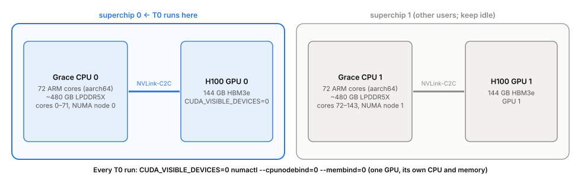

::: {.reader-note}
**Who this is for.** A first-year physics graduate student who knows Python, Linux, quantum mechanics and
statistical physics, but not much chemistry. Every chemistry term is explained the first time it appears and
collected in the [glossary](#glossary).

**How it relates to the plan.** The authoritative work plan is `docs/plan/T0_T0b_execution_plan_GH200.md`
(cited as *plan §n*). This report does not replace it, and it does not restate the pass criteria. It explains
*why* the pieces exist and *how they fit together*, so that the plan reads easily afterwards. Measured facts come
from `docs/plan/GH200_feasibility_check_2026-11-07.md` (cited as *feasibility §X*).

**Interactive figures.** In the HTML version, figures marked ▸ *interactive* can be explored (pick a molecule,
switch a spectrum, filter the timing data, browse every package in a container). The PDF and EPUB versions show
the same figures as static images.
:::

# 1. The goal in one page {#goal}

Interstellar space glows in a handful of broad infrared emission bands at 3.3, 6.2, 7.7, 8.6, 11.2 and
12.7 µm. They are seen in almost every galaxy, and they come from **polycyclic aromatic hydrocarbons (PAHs)**:
flat molecules made of carbon atoms arranged in hexagons, like small flakes of graphene, with hydrogen atoms
on the edges. A PAH absorbs one ultraviolet photon from a star, heats up to several hundred kelvin, and cools
down by emitting infrared light at the frequencies at which it vibrates.

Because millions of molecules of thousands of kinds contribute, the bands tell us about the **population**:
how many of the PAHs are ionised (positively charged), how big they are, what their edges look like. Those
population properties in turn tell us about the physical conditions (UV field, gas density, temperature)
where the PAHs live. Astronomers already use **band ratios** such as 6.2/11.2 as rough tracers of ionisation.
They were chosen by intuition and calibrated on small samples.

**The project asks:** given everything we can compute about PAH spectra, what is the *best readable formula*
that turns measured band strengths into a population property, and how good can it be? It answers with
**symbolic regression**: a search over mathematical expressions, scored on tens of thousands of synthetic
spectra with known answers, that returns short formulas instead of a black-box model.

::: {.figure #fig-big-picture}

:::

The first two months of work, which this report is about, are two **de-risking tasks**:

- **T0, the stack benchmark** (GPU): which software should run the molecular dynamics that later improves
  the spectra? It compares a JAX stack with the standard PyTorch stack, on the same model at the same
  precision. Section [4](#t0) explains it.
- **T0b, the vertical slice** (CPU): run every stage of the pipeline once, on a deliberately tiny input
  (25 molecules, 2,000 synthetic populations), from the database to real JWST spectra of the Orion Bar.
  It ends with a *closure test*: the formula search must rediscover a ratio we already know works.
  Section [3](#t0b) explains it.

::: {.figure #fig-roadmap}

:::

# 2. Physics primer: molecules, vibrations and bands {#primer}

This section gives the minimum chemistry needed to follow the rest. If you know what "a duo hydrogen" and
"a cation" are, skip to Section [3](#t0b).

## 2.1 What a PAH looks like

Take a sheet of graphene and cut out a small flake. The carbon atoms on the rim now have a dangling bond each;
cap every one with a hydrogen atom. That is a PAH. *Polycyclic* means many rings, *aromatic* means the rings
share their electrons in delocalised π orbitals (the same physics as graphene's band structure), and
*hydrocarbon* means only C and H.

- **Formula.** C₂₄H₁₂ means 24 carbon and 12 hydrogen atoms. This one is **coronene**: seven hexagons, one in
  the centre and six around it. Sizes in this project run from about 20 to about 110 carbons
  (*plan §5.1*).
- **Compact or irregular.** Compact PAHs are nearly round (coronene, circumcoronene C₅₄H₁₈). Irregular ones
  are elongated or have notches in the edge ("bays").
- **Neutral or cation.** A cation has lost one electron (charge +1, written C₂₄H₁₂⁺). Its shape barely changes,
  but its electron distribution does, and that changes how strongly each vibration couples to light.
- **Edge hydrogens come in groups.** Walk around the rim. Each carbon that carries an H belongs to a run of
  neighbouring H-carrying carbons. A run of one is a **solo** H, two a **duo**, three a **trio**, four a
  **quartet**. This edge structure matters because the out-of-plane bending vibration of the C–H bonds has a
  different frequency for each group size (Section 2.2).

::: {.figure #fig-molecules data-widget="molecules"}

:::

The counts in the figure are computed from the geometry by the report's own script and agree with the counts
the selection script derived from PAHdb's boundary-edge code (`slice/species.csv`; *plan §5.1*).

## 2.2 Vibrations and the bands

A molecule with N atoms is a system of N masses joined by springs (the chemical bonds), so to first order it has
3N − 6 **normal modes**, each a harmonic oscillator with its own frequency. Coronene, with 36 atoms, has 102.
A normal mode emits or absorbs infrared light only if it changes the molecule's electric dipole moment; the
square of that change sets the band's **intensity**.

Chemists quote frequencies as **wavenumbers** ν̃ = 1/λ in cm⁻¹, and astronomers as wavelengths λ in µm. The
conversion is λ [µm] = 10⁴ / ν̃ [cm⁻¹]: 3,030 cm⁻¹ is 3.3 µm and 893 cm⁻¹ is 11.2 µm.

| Band (µm) | ≈ cm⁻¹ | What moves | What it is sensitive to |
| --- | --- | --- | --- |
| 3.3 | 3,030 | C–H bond stretching (the light H bounces against the C) | strong in small, hot, neutral PAHs |
| 6.2 | 1,610 | C–C bond stretching in the rings | strong in cations |
| 7.7 | 1,300 | C–C stretching mixed with in-plane C–H bending | strong in cations |
| 8.6 | 1,160 | C–H bending in the molecular plane | strong in cations |
| 11.2 | 890 | C–H bending out of the plane, **solo** H | strong in neutrals |
| 12.0 / 12.7 / 13.5 | 830 / 790 / 740 | out-of-plane bending of **duo / trio / quartet** H | edge structure (and charge, for 12.7) |

The out-of-plane positions are from Bauschlicher et al. 2018 §4 as quoted in *plan §5.1*. The 12.7 µm complex
also carries charge information (trio H in cations; Chown et al. 2024 §3.6), which is why the plan treats
12.7/11.2 as a legitimate predictor rather than a leak.

**Where the numbers come from.** We cannot measure the spectra of thousands of PAHs in the laboratory, so they are
computed with **density functional theory (DFT)**, a quantum-mechanical method for the electronic ground state.
For each molecule, DFT gives the equilibrium geometry, the normal-mode frequencies and the intensities
(in **km/mol**, the integrated absorption cross-section per mole of molecules). The NASA Ames PAH IR
Spectroscopic Database (**PAHdb**, version 4.00) collects them for 10,749 species (*feasibility §I*). Its
frequencies are scaled by an empirical factor to compensate for systematic DFT errors.

## 2.3 Charge changes the spectrum

::: {.figure #fig-spectrum data-widget="spectra"}

:::

Two things to read from Figure 4:

1. **Charge moves power between the bands.** The neutral emits mostly at 3.3 µm and in the out-of-plane band;
   the cation emits mostly at 6–9 µm and almost nothing at 3.3 µm. This is the effect a band ratio like
   6.2/11.2 exploits.
2. **Edge structure moves the out-of-plane band.** Coronene has only duo H, so its out-of-plane band sits near
   11.6 µm, not at 11.2 µm (the solo position). Compact PAHs below about 50 carbons are duo-dominated, so their
   "11.2" emission is weak (*plan §5.1*). That is why the slice checks the 11.2 µm denominator at the
   population level, and why it must **not** select only solo-bearing species (the selection bias Wang 2026
   Fig. 1 warns about).

## 2.4 From a cold molecule to a hot emitter: the cascade model

DFT describes a cold molecule. In space, a PAH absorbs a UV photon of a few eV. The energy is redistributed over
all vibrational modes within picoseconds (internal conversion), so the molecule becomes a small,
isolated, **microcanonical** system: a fixed total energy E shared among 3N − 6 oscillators. It then cools by
emitting infrared photons one at a time, each taking away a quantum hν of one mode, over about a second.

The **cascade model** follows this cooling. At each energy it assigns the molecule an effective temperature
T(E) from its heat capacity, weights each band's emission by the probability that its mode is excited at
that temperature (a Planck-like factor), and integrates over the whole cooling history. The result: bands at
short wavelengths (high frequency, like 3.3 µm) shine only while the molecule is hottest, so they are
relatively stronger for small molecules, which a given photon heats more. PAHdb's Python suite implements
this model; T0b uses a fixed 6 eV photon with no band shift (*plan §5.3*).

## 2.5 Populations and the inverse problem

An observed spectrum is a weighted sum over molecules. In T0b, a **population** is defined by two numbers: the
typical size (a log-normal distribution of carbon number) and the **ionised fraction f**, the fraction of
molecules that are cations (*plan §5.4*). At fixed size weights, the population spectrum is *linear* in f:

$$S(\mathrm{\lambda}; f) = (1 - f)\,S_0(\mathrm{\lambda}) + f\,S_1(\mathrm{\lambda}),$$

where S₀ and S₁ are the pure-neutral and pure-cation spectra. A band strength is an integral of S, so it is
also linear in f, and any band ratio has the form

$$r(f) = \frac{A_0 + f\,\mathrm{\Delta} A}{B_0 + f\,\mathrm{\Delta} B}.$$

Inverting this gives the exact one-ratio answer

$$f = c_1 + \frac{c_2}{c_3 - r},$$

which in PySR's counting has complexity 7 (*plan §5.9*). This is the **closure test**: on our own synthetic data,
the formula search should find something equivalent to this. Because the training data come from our own
forward model, passing it proves that the pipeline stages fit together; it does not prove that the physics is
right. The plan adds controls that make the test informative (injection–recovery, analytic endpoints, an
out-of-basis continuum, shuffled labels; *plan §5.9*).

# 3. T0b: the vertical slice {#t0b}

The slice runs the whole data pipeline on an input small enough to finish in hours, so that plumbing problems
appear now rather than after a large allocation has been spent. Every stage is a script that reads and writes
one HDF5 file, `slice.h5`, and `make slice` reruns the chain (*plan §5*). It runs on the Grace CPU, in
container C (Section [6.5](#cC)).

::: {.figure #fig-pipeline}

:::

| Stage | Input → output | Physics or method | Main check |
| --- | --- | --- | --- |
| 1 Species | PAHdb → `species.csv` (25 pairs; done, commit `bc7767e`) | size ladder 20–110 C, 18 compact + 7 irregular, no N/O, no pentagons | pairs span the same size range in each class |
| 2 Spectra | → band lists | DFT harmonic frequencies, km/mol | stick plots |
| 3 Cascade | → emission spectra | 6 eV photon, 15 cm⁻¹ Gaussian | 3.3 µm weak for big molecules; 6–9 µm strong in cations |
| 4 Populations | → 2,000 spectra + labels | Latin hypercube over size and f | 11.2 µm denominator domain declared in advance |
| 5 Instrument | → mock JWST spectra | MIRI MRS resolution, dust continuum, S/N 50 noise | continuum stays realistic |
| 6 PAHFIT | → `features.csv` | fits Drude profiles + continuum; Monte Carlo refits for errors | `maxiter=10000`, converged flag |
| 7 Features | → ratios, baselines | random forest (reference), one-ratio monotone fit, constant | frozen feature schema |
| 8 PySR | → Pareto front of formulas | evolutionary search over expressions | shuffled-label control does no better than a constant |
| 9 Orion Bar | → predictions for 5 templates | the chosen formula on real JWST data | domain coverage, validity, spread vs errors (not a gate) |

Stages 2 and 3 are what Figure 4 shows, made with the same package (AmesPAHdbPythonSuite) and settings the slice
will use.

# 4. T0: the stack benchmark {#t0}

## 4.1 Why molecular dynamics at all

The DFT spectra in PAHdb are **harmonic** and **cold**: each mode is an ideal spring, and the molecule sits at
its minimum. Real hot PAHs are anharmonic: bands shift and broaden with temperature, and modes exchange energy.
**Molecular dynamics (MD)** captures this directly. Integrate Newton's equations for the atoms at a realistic
temperature, record the dipole moment μ(t), and the infrared spectrum is the Fourier transform of its
autocorrelation,

$$I(\mathrm{\omega}) \propto \int \langle \mathrm{\mu}(0)\cdot\mathrm{\mu}(t)\rangle\, e^{-i\mathrm{\omega} t}\, dt .$$

(The same with velocities instead of the dipole gives the **vibrational density of states**, VDOS: where the
modes are, without their infrared intensities.) MD needs forces at every femtosecond step; DFT forces are far too
expensive for nanoseconds of many molecules. A **machine-learned interatomic potential** (MLIP) trained on DFT
reproduces them at a tiny fraction of the cost. The project uses **MACE**, and T0 uses one published MACE
model, **MACE-OFF23 small** (trained on organic molecules; neutral, closed-shell molecules only, so it cannot
produce cation trajectories; *plan §4.2*).

::: {.figure #fig-mlip}

:::

::: {.figure #fig-vdos}
![**Figure 7.** Coronene at 600 K, 1 ps of MD with MACE-OFF23 small in each stack (the 2026-11-08 driver smoke
runs), VDOS from the atomic velocities, compared with PAHdb's harmonic DFT bands (grey). The two stacks agree;
both differ from PAHdb. The main offset is that PAHdb's frequencies are empirically scaled DFT values while the
MD uses the unscaled potential; the anharmonic red-shift at 600 K pulls the other way. 1 ps of MD also resolves
only about 30 cm⁻¹. This is a check of units and
plumbing, not a spectrum to use.](figures/md_vdos.svg)
:::

## 4.2 The question T0 answers

PAHs are small (34–144 atoms in T0's 20 species). The standard workflow, **ASE** (a Python MD driver) calling a
**PyTorch** MACE model on the GPU, one molecule at a time, keeps the GPU mostly idle: each step goes from Python
on the CPU to a tiny GPU computation and back. **JAX** can compile the whole MD loop, for many molecules at once,
into one GPU program. The hypothesis is that this is much faster. T0 measures it, and the answer decides which
software the MD of the whole project is built on (*plan §1*).

::: {.figure #fig-mdloop}

:::

A fair comparison has to give PyTorch its best chance too. "You did not batch PyTorch" is the obvious
objection, so T0 measures four ways of running *b* molecules (*plan §4.3*):

::: {.figure #fig-batching}

:::

## 4.3 What "fair" means here

The plan spends most of its T0 text on fairness, because small, silent differences could move the answer by
more than the 5× threshold. In short (details in *plan §4.2–4.4*):

- **Same model, checked.** The PyTorch checkpoint is converted into mace-jax's format, and the two are compared
  on 120 geometries (20 species × 6). The gate passed on 2026-11-08: forces agree to 3.0×10⁻⁵ eV/Å (limit
  10⁻³), interaction energies to 4.2×10⁻⁶ eV/atom (limit 10⁻⁴), float64 totals to 2.7×10⁻⁷ eV/atom (limit
  10⁻⁶) (*feasibility §J*).
- **Same precision.** float32 everywhere, with TF32 (a reduced-precision matrix mode of the H100) switched off
  in both stacks; library defaults differ silently.
- **Same physics.** Langevin thermostat at 600 K, friction 0.01 fs⁻¹, time step 0.5 fs, identical initial
  velocities, one centre-of-mass policy, equal work (energy, forces and a dipole proxy; no stress).
- **cuEquivariance** (NVIDIA's fused GPU kernels for MACE's equivariant operations) **on and off in both
  stacks.** For JAX, "on" is taken to mean `conv_fusion: true`, the only setting in mace-jax 0.2.0 that
  reaches a cuEquivariance kernel, and then only for the convolution. *This definition is pending committee
  confirmation (2026-11-09).*
- **Same hardware slice** (Section [5](#hw)), nothing else on the GPU, three repeats.

## 4.4 The decision rule and a first look at the numbers

Cost is measured in **seconds of wall-clock time per molecule-picosecond** of simulation, at batch 1, 10 and 100.
At batch 100 and matched precision, JAX is compared against the *fastest* validated PyTorch mode: more than 5×
faster → JAX for the project; 2–5× → JAX for the MD loop, PyTorch kept as reference; below 2× → PyTorch
(*plan §4.5*).

::: {.figure #fig-timing data-widget="timing"}

:::

Read the calibration figure as a preview only. At batch 100 the best JAX time (0.17 s per molecule-ps, with
`conv_fusion`) is about 2.9× faster than the best PyTorch mode (TorchSim with cuEquivariance, 0.50), inside the
2–5× band. Two plan-mandated caveats apply to any outcome: the GH200's fast CPU–GPU link flatters the PyTorch
baseline compared with a conventional cluster node, and the result depends on which cuEquivariance setting
each stack ran.

# 5. The machine {#hw}

The project node is a **dual GH200**: two "superchips", each one ARM CPU (Grace, 72 cores) joined to one H100
GPU by a fast link (NVLink-C2C) that lets the GPU read CPU memory directly. Two consequences shape everything
in the containers:

- **ARM (aarch64), not x86.** Every binary, wheel and container image must be built for ARM. An x86 image fails
  with "exec format error".
- **One superchip per experiment.** T0 runs on GPU 0 and the 72 cores of its own Grace (NUMA node 0), so that
  processes never straddle the slower link between the two sockets. The other superchip belongs to other users.

::: {.figure #fig-hw}

:::

# 6. The containers {#containers}

## 6.1 Why containers, and why three

The stacks pull in incompatible pieces: JAX ships its own CUDA 12.9 libraries as pip wheels, NVIDIA's PyTorch
build is tied to CUDA 13.4, and PySR runs a whole Julia installation. Put them in one environment and they
collide, sometimes silently (Section 6.3 has an example where JAX quietly fell back to the CPU). So each stack
gets its own **container image**: a single read-only file (`.sif`) holding an operating system, a Python and
every package, built once from a recipe (`containers/*.def`) and run identically by anyone.

**Apptainer** (formerly Singularity) is the HPC container system. Unlike Docker it runs as the ordinary user,
sees your home directory, and needs no daemon. The commands you will use:

```bash
apptainer build --fakeroot A_jax.sif containers/A_jax.def    # build an image from a recipe
apptainer exec --nv A_jax.sif python script.py               # run a command inside; --nv = give it the GPU
apptainer exec --bind /var/tmp/x:/data C_cpu.sif ls /data    # make a host directory visible inside
apptainer exec --containall --env VAR=1 C_cpu.sif ...        # clean environment, no automatic home mount
```

`--nv` binds the *host's* NVIDIA driver into the container. This is the one piece every GPU container shares
with the host, and the source of the forward-compatibility story in Section 6.4.

::: {.figure #fig-layers}

:::

| Image | Used by | GPU? | Base | Recipe |
| --- | --- | --- | --- | --- |
| **A** `A_jax.sif` (7.1 GB) | T0: JAX MD driver, weight converter | yes | `ubuntu:24.04` | `containers/A_jax.def` |
| **B** `B_torch.sif` (12 GB) | the verified PyTorch baseline; the PyTorch side of the equivalence gates | yes | `nvcr.io/nvidia/pytorch:26.10-py3` | `containers/B_torch.def` |
| **B+** `B_torchsim.sif` (13 GB) | T0 timing: **every** PyTorch mode (sequential, MPS pool, TorchSim, concatenated), so the whole PyTorch column runs on one image | yes | `B_torch.sif` | `containers/B_torchsim.def` |
| **C** `C_cpu.sif` (1.3 GB) | T0b: every slice stage; PAHdb tools | no | `ubuntu:24.04` | `containers/C_cpu.def` |

The images live on local NVMe (`/var/tmp/jjlee-pah/sif/`), not in the repository; their SHA-256 hashes are in
`containers/images-sha256-2026-11-07.txt`, and the full in-image package lists in
`containers/requirements-*-container.txt`. Package versions in this report are read from those lists and from
`pip show` inside the images (`docs/report/data/pipshow_*.txt`).

**Common rules for all three** (*plan §3.3*): Python 3.12 (current JAX needs ≥ 3.12); one environment per image
and always `python -m pip`, so `pip` and `python` cannot disagree; pinned versions, and `pip check` at the end
of the build.

## 6.2 How the containers talk to each other

They never import each other's code. They exchange **files** on the host, and the order matters:

::: {.figure #fig-dataflow}

:::

## 6.3 Container A: the JAX stack {#cA}

**Job.** Run the JAX MD driver `t0/md_jax.py`, and convert the PyTorch MACE checkpoint to mace-jax's format.

**The recipe in plain words** (`containers/A_jax.def`):

1. Start from plain `ubuntu:24.04`, install Ubuntu's Python 3.12 and make a virtual environment `/opt/venv`.
2. Install a **CPU-only PyTorch first.** mace-jax depends on `e3nn==0.4.4`, which is the PyTorch version of e3nn,
   so it drags in PyTorch. Installed first, the CPU wheel satisfies that; installed second, pip says "already
   satisfied" and you end up with a 2.15.0+cu132 CUDA PyTorch beside JAX's CUDA. A build-time assert checks
   for `+cpu`.
3. Install `mace-jax[jax-cuda12]` from a pinned git commit (`e8a6f2d`, 2026-10-29). mace-jax chooses the JAX
   version (0.11.2) and the cuEquivariance version (0.10.0).
4. Add `jax-md`, `flax`, `optax`, `ase`, numerics, and `mace-torch` (only the converter needs it).
5. Put JAX's pip CUDA libraries on `LD_LIBRARY_PATH`, because `cuequivariance_ops` loads its library before JAX
   has loaded CUDA, and would otherwise fail with `libnvrtc.so.12: cannot open shared object file`.
6. At run time: `JAX_PLATFORMS=cuda` (fail loudly instead of falling back to the CPU) and
   `JAX_DEFAULT_MATMUL_PRECISION=highest` (no TF32).

::: {.callout}
**The silent-CPU trap (*feasibility*, container builds).** The first build used an NVIDIA CUDA-toolkit base image,
which brought CUDA 12.8 system libraries next to the CUDA 12.9 wheels that JAX installs. When cuEquivariance
was imported before JAX, the 12.8 libraries loaded first, JAX failed to load cuSPARSE, and **it fell back to the
CPU without an error**, still writing correct-looking predictions. The fix is the rule "exactly one CUDA in
the image" (plain Ubuntu base) plus `JAX_PLATFORMS=cuda`, which turns any fallback into an error.
:::

::: {.figure #fig-depsA data-widget="deps" data-image="A_jax"}

:::

| Package (version) | What it is | Why it is here / who pulls it in |
| --- | --- | --- |
| **mace-jax** 0.2.0 | MACE re-implemented in JAX: model, weight converter `mace-jax-from-torch`, predictor | the JAX side of T0 (recipe) |
| **jax** / **jaxlib** 0.11.2 | NumPy-like arrays + automatic differentiation + the XLA compiler that turns Python functions into GPU programs | the numerical engine; version chosen by mace-jax (caps JAX < 0.12) |
| jax-cuda12-plugin / -pjrt 0.11.2 | JAX's GPU backend | `mace-jax[jax-cuda12]` extra |
| nvidia-*-cu12 (12.9) | CUDA runtime, cuBLAS (matrix multiply), cuDNN, cuSPARSE, cuFFT, NVRTC (runtime compiler), NCCL… as pip wheels | JAX's CUDA; the only CUDA in this image |
| **jax-md** 0.2.29 | MD in JAX: integrators (`nvt_langevin`), spaces, neighbour lists | the integrator of `md_jax.py` (recipe) |
| e3nn-jax 0.21.0 | equivariant neural-network layers in JAX (irreducible representations of rotations) | mace-jax and jax-md |
| jraph 0.0.6.dev0 | graph neural network data structure (padded graphs with node/edge caps) | mace-jax's batching format |
| **flax** 0.12.12 / **optax** 0.2.8 / chex | neural-network modules / optimisers / test helpers for JAX | mace-jax's model code |
| cuequivariance 0.10.0 | NVIDIA's description of equivariant polynomials (pure Python) | mace-jax's cueq backend |
| cuequivariance-jax 0.10.0 | its JAX front end (`cuex.segmented_polynomial`) | mace-jax |
| cuequivariance-ops-jax-cu12 / -ops-cu12 0.10.0 | the compiled CUDA kernels (`libcue_ops.so`) | used only with `conv_fusion: true` (Section 4.3) |
| **torch** 2.15.0+cpu | PyTorch, CPU-only build | needed by e3nn and mace-torch (conversion, and building the cueq-off model); never touches the GPU here |
| e3nn 0.4.4 | the PyTorch e3nn | required by mace-torch (conversion) and by mace-jax itself: the cueq-off model takes its Clebsch–Gordan tables from `e3nn.o3.wigner_3j` when it is built, to match the PyTorch sign convention. Build time only, not inside the MD loop |
| **mace-torch** 0.3.17 | the reference MACE in PyTorch | the converter imports `mace.calculators` to load the checkpoint |
| **ase** 3.29.0 | Atomic Simulation Environment: `Atoms`, file formats, units | reading XYZ, unit constants (recipe) |
| matscipy 1.3.1 | fast neighbour lists for ASE | mace-torch / mace-jax |
| pymatgen | materials-science toolkit | pulled in by jax-md, not used by us |
| h5py, numpy, scipy, matplotlib | HDF5 files, arrays, numerics, plots | recipe |
| orbax-checkpoint, tensorstore, google-cloud-* | checkpointing and cloud storage for flax | pulled in by flax, not used by us |

## 6.4 Container B: the PyTorch stack, and B + TorchSim {#cB}

**Job.** Run `t0/md_torch.py` in all PyTorch modes (sequential, MPS pool, TorchSim, concatenated `Atoms`) and the
PyTorch side of the equivalence gates.

**Why start from NVIDIA's image.** NGC (NVIDIA GPU Cloud) PyTorch containers carry a PyTorch built and tuned by
NVIDIA for its GPUs, with matching CUDA, cuDNN and compilers, for ARM as well as x86. Tag `26.10-py3` has
PyTorch 2.15.0a0 and CUDA 13.4 (*plan §3.3*). The price: about 250 extra packages for other workloads (large
language models, inference, vision), and a CUDA newer than the node's driver.

**The recipe in plain words** (`containers/B_torch.def`):

1. Write NGC's own `torch`, `triton` and `nvidia-*` versions into a **constraints file**, so that pip may not
   replace them with PyPI builds.
2. Record `pip check`'s complaints about the *untouched* NGC image (it already has some, all NVIDIA's own), and
   fail the build only on *new* complaints.
3. Install `mace-torch[cueq,cueq-cuda-13]`, cuEquivariance 0.10.0 for PyTorch with CUDA 13 kernels, `ase`, `h5py`.
4. Check that torch and triton are unchanged.
5. At run time, unset `TORCH_ALLOW_TF32_CUBLAS_OVERRIDE`, which NGC sets to 1 (it would turn on TF32).

`B_torchsim.def` builds a second image on top of B that adds only `torch-sim-atomistic` under the same
constraints, so that a TorchSim problem cannot break the verified baseline image. Once it passed, the timing grid
ran every PyTorch mode in B+ (one image hash, `3ab99a07…`, in every PyTorch row of the timing CSV); B alone
served the equivalence gates (*feasibility §J*).

::: {.callout}
**Forward compatibility and MPS.** The node's NVIDIA driver is 595.45 (CUDA 13.2); NGC 26.10 wants 615.71
(CUDA 13.4). It still runs, because the image ships a newer user-space driver library (`libcuda.so.615.71`, the
"compat" library) that the data-centre driver accepts. One consequence surfaced only with MPS: an MPS daemon
started on the host (driver 595.45) accepted clients from the container and then left them hanging forever in
`cuInit`. The fix is to run the daemon **inside the image**, so that it uses the same compat library as its
clients (`t0/run_mps.sh`, *feasibility §K*). *The plan sentence describing this is pending committee
confirmation (2026-11-09).* If forward compatibility ever breaks after a driver change, `26.03-py3` is the
native match for driver 595.45.
:::

::: {.figure #fig-depsB data-widget="deps" data-image="B_torchsim"}

:::

| Package (version) | What it is | Why it is here / who pulls it in |
| --- | --- | --- |
| **torch** 2.15.0a0 (NGC build) | PyTorch: tensors, autograd, CUDA kernels | from the NGC image; protected by the constraints file |
| triton 3.8.0 | compiler for custom GPU kernels | NGC; used by PyTorch internals |
| **mace-torch** 0.3.17 | MACE in PyTorch: model, `mace_off()` loader, ASE calculator, TorchSim adapter | the reference implementation (recipe) |
| e3nn 0.4.4, opt-einsum-fx | equivariant layers in PyTorch; tensor-contraction optimiser | mace-torch |
| **cuequivariance** / **-torch** 0.10.0 | NVIDIA's equivariant-polynomial description and its PyTorch modules | recipe; `enable_cueq=True` swaps MACE's layers for these (88 modules) |
| **cuequivariance-ops-torch-cu13** / -ops-cu13 0.10.0 | the CUDA 13 kernels; a small extension that does not link libtorch, so no PyTorch ABI risk | recipe |
| nvidia-cublas, nvidia-cuda-nvrtc (13.x pip) | CUDA libraries the cueq kernels load | -ops-cu13 |
| **ase** 3.29.0 | `Atoms`, `Langevin` and `VelocityVerlet` integrators, the calculator interface | the sequential, MPS and concatenated drivers (recipe) |
| matscipy 1.3.1 | neighbour lists | mace-torch |
| torch-ema, torchmetrics, lmdb, orjson, gitpython, prettytable, configargparse | training-time utilities of mace-torch | mace-torch; not used by the MD drivers |
| **h5py** 3.16.0 | HDF5 files | recipe; TorchSim trajectories |
| **torch-sim-atomistic** 0.6.2 *(B+ only)* | TorchSim: batched MD of many systems in one PyTorch state | the batched PyTorch candidate (recipe) |
| nvalchemi-toolkit-ops 0.5.0, warp-lang 1.19.0 *(B+ only)* | NVIDIA's GPU neighbour lists, written in Warp (a Python-embedded kernel language) | TorchSim |
| tables, blosc2, numexpr *(B+ only)* | PyTables (HDF5) and compression | TorchSim's trajectory writer |
| tensorrt, transformer_engine, flash_attn, torchvision, torchao, apex, … | inference engine, LLM training kernels, attention kernels, vision models | NGC payload; **not used by T0** |

## 6.5 Container C: the CPU tools {#cC}

**Job.** Everything in the T0b slice, and PAHdb access for both tasks (species selection, geometries).

**The recipe in plain words** (`containers/C_cpu.def`):

1. Start from `ubuntu:24.04`, install **uv** (a fast Python package manager) and let it install a standalone
   CPython 3.12.14, *not* Ubuntu's Python. The reason is the box below.
2. Install `pysr`, `astropy`, `specutils`, `scikit-learn`, `pandas`, `h5py`, `matplotlib`, `jupyter`.
3. Install **PAHFIT** and **AmesPAHdbPythonSuite** from pinned git commits (`ca599f9`, `e8961b2`), not from PyPI.
   PAHFIT's only PyPI release (2.0, 2022) has the old API and lacks the `classic.yaml` science pack and the
   `jwst.yaml` instrument pack the slice relies on.
4. Run `import pysr` once during the build: that downloads Julia 1.13.3 and compiles PySR's Julia backend into
   the image (about 2 minutes).
5. At run time, Julia needs a *writable* project directory, so each job copies `/opt/julia_env` to scratch and
   binds the copy over the original path (*plan §3.3*, "Run-time Julia setup").

::: {.callout}
**Why not Ubuntu's Python? (*feasibility*, container builds).** PySR is a Python front end to a Julia program
(SymbolicRegression.jl), connected by juliacall. juliacall makes Julia use the same OpenSSL library as the
Python interpreter. Ubuntu 24.04's Python links OpenSSL 3.0, which forced Julia 1.11.9, and PySR then crashed
(segmentation fault) inside Julia on its first fit. uv's CPython links OpenSSL 3.5, gets Julia 1.13.3, and works.
:::

::: {.figure #fig-depsC data-widget="deps" data-image="C_cpu"}

:::

| Package (version) | What it is | Why it is here / who pulls it in |
| --- | --- | --- |
| **amespahdbpythonsuite** 0.5.0.post96 (git `e8961b2`) | NASA Ames PAHdb's Python tools: database reader, geometry (`bec()` edge codes), cascade emission model, convolution | stages 1–3 (recipe) |
| lxml, vtk, fnnls | XML parser (the 503 MB database), 3-D visualisation, non-negative least squares | the suite |
| **pahfit** 2.6.dev93 (git `ca599f9`) | decomposes an IR spectrum into dust continuum + Drude-profile bands + gas lines | stage 6 (recipe) |
| **astropy** 8.0.2 | units, tables, FITS files, modelling and fitting | PAHFIT, the suite |
| **specutils** 2.4.0, gwcs, ndcube, asdf | spectrum objects (`Spectrum1D`) with wavelength coordinates; their file formats | PAHFIT's input format, the suite |
| **pysr** 2.7.2 | symbolic regression: an evolutionary search over expression trees, scored on accuracy and complexity | stage 8 (recipe) |
| juliacall 0.9.36, juliapkg 0.1.28 | call Julia from Python; install Julia and Julia packages | PySR |
| Julia 1.13.3 + SymbolicRegression.jl | the actual search engine | juliapkg, at build time |
| **scikit-learn** 1.9.1 | random forests, isotonic regression, train/test utilities | stage 7 (recipe); also required by PySR |
| **pandas**, **h5py**, **matplotlib** | tables, HDF5 (`slice.h5`), plots | recipe |
| jupyter (and its many dependencies) | notebooks for inspection | recipe; convenience only |

# 7. Where things stand (2026-11-09) {#status}

| Item | State |
| --- | --- |
| Containers A, B, B+, C | built and tested on the node (2026-11-07) |
| Smoke tests, equivalence gate (§4.2) | passed (2026-11-08) |
| T0 MD drivers, MPS pool | written and smoke-tested (`t0/`) |
| T0b species selection | done (`slice/species.csv`) |
| T0 timing grid | running: 93 cells, 3 repeats, about 36 hours; calibration pass complete |
| Committee confirmations | pending: the JAX "cuEquivariance on" definition, the MPS-daemon sentence |
| T0b stages 2–9 | not started |

# Glossary {#glossary}

| Term | Meaning |
| --- | --- |
| aarch64 / ARM | the CPU architecture of the Grace chip; software must be built for it |
| AIB | aromatic infrared band, one of the PAH emission features |
| Apptainer, `.sif` | HPC container system; a `.sif` file is one read-only image |
| ASE | Atomic Simulation Environment: Python objects for atoms, integrators and calculators |
| aromatic | rings whose π electrons are delocalised, as in benzene and graphene |
| batch *b* | number of trajectories of total work in one timed run |
| cascade model | turns cold DFT bands into the emission of a molecule cooling after a UV photon |
| cation | a molecule that has lost one electron (charge +1) |
| compact / irregular | round PAHs with smooth edges / elongated PAHs or PAHs with bays |
| cuEquivariance (cueq) | NVIDIA's library of fused GPU kernels for equivariant networks |
| CUDA, driver, forward compatibility | NVIDIA's GPU programming stack; the kernel driver on the host; running a newer CUDA on an older data-centre driver through a "compat" library |
| DFT | density functional theory, the quantum-chemistry method behind PAHdb |
| Drude profile | the band shape PAHFIT fits (a damped-oscillator line shape with broader wings than a Gaussian) |
| equivariant | a network whose outputs rotate when the input molecule rotates |
| f | ionised fraction: the fraction of molecules in a population that are cations |
| JAX, XLA, `jit`, `scan` | Python array library with autodiff; its compiler; compile a function; compile a loop |
| isotonic (monotone) regression | the best-fitting function of one variable that only increases (or only decreases); the one-ratio baseline |
| km/mol | unit of integrated IR band intensity (absorption cross-section per mole) |
| Latin hypercube | a sampling design that spreads N points evenly along every parameter axis at once |
| MACE, MACE-OFF23 | the ML potential family; the published organic-molecule model T0 uses |
| MD, Langevin thermostat | molecular dynamics; MD with friction and random kicks that hold a temperature |
| MIRI MRS | JWST's mid-infrared integral-field spectrograph (5–28 µm) |
| MLIP | machine-learned interatomic potential |
| Monte Carlo refit | add noise to a spectrum many times, refit each copy, and take the spread of the results as the uncertainty |
| MPS | CUDA Multi-Process Service: lets several processes share one GPU concurrently |
| NGC | NVIDIA GPU Cloud, the registry of NVIDIA's tuned containers |
| NUMA node | a CPU socket and its local memory; crossing to another socket is slower |
| PAH | polycyclic aromatic hydrocarbon |
| PAHdb | NASA Ames PAH IR Spectroscopic Database (v4.00) |
| PAHFIT | software that decomposes an IR spectrum into bands, continuum and lines |
| Pareto front | the formulas for which no other is both simpler and more accurate |
| PDRs4All, Orion Bar | the JWST programme and the region whose five template spectra T0b uses |
| PySR | symbolic-regression package (Python front end, Julia engine) |
| solo / duo / trio / quartet H | 1, 2, 3 or 4 adjacent H-carrying carbons on the molecule's edge |
| TF32 | a reduced-precision matrix mode on NVIDIA GPUs; switched off in T0 |
| TorchSim | batched MD library for PyTorch |
| VDOS | vibrational density of states, the Fourier transform of the velocity autocorrelation |
| wavenumber (cm⁻¹) | 1/λ; λ [µm] = 10⁴ / ν̃ [cm⁻¹] |

# Appendix: every installed package {#appendix}

The tables in Section 6 cover the packages that matter. The complete lists, with each package's one-line
summary from its own metadata and the packages that require it, are generated from the images by
`docs/report/scripts/appendix.py` and follow below.
