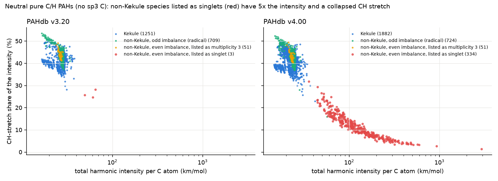
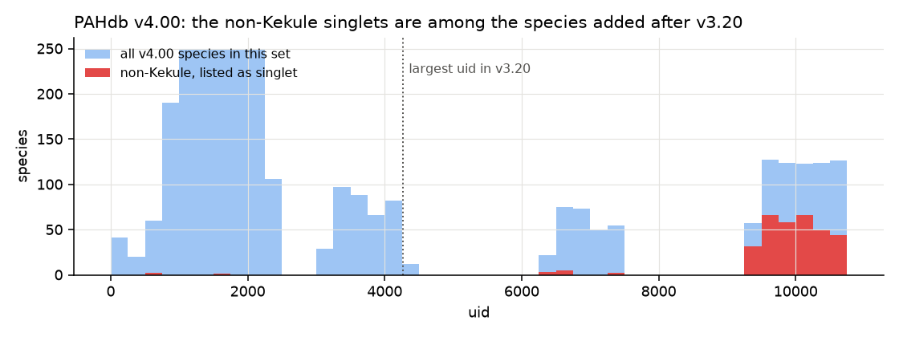
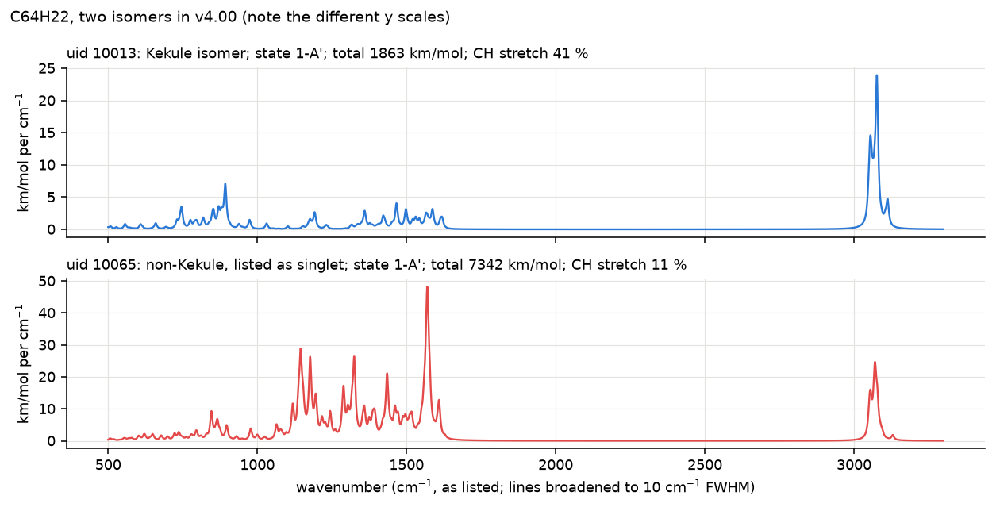
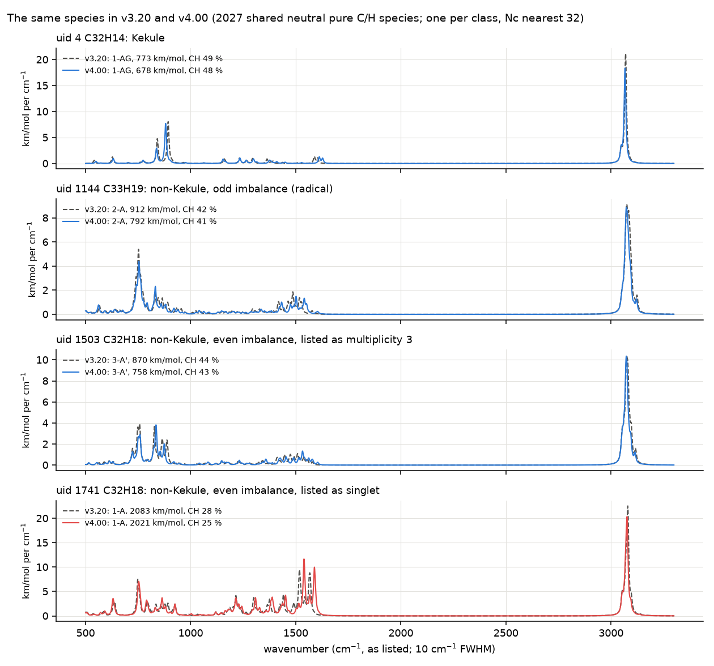

# Non-Kekulé PAHs listed as closed-shell singlets in PAHdb computational v4.00

*Short note, 2026-11-16. Data: NASA Ames PAH IR Spectroscopic Database, computational versions 3.20 (2019-09-12) and
4.00. Everything below is reproduced by `pahdb_nonkekule.py` from the two public XML files.*

## Summary

PAHdb v4.00 contains **334 neutral pure-C/H PAHs whose carbon framework has no Kekulé structure but whose electronic
state is listed as a singlet** ("1-A", "1-A'", ...). Of these, 331 are new since v3.20; their uids are 6422–10770, most
above ~9,300.

A neutral alternant hydrocarbon without a Kekulé structure cannot be closed-shell. Lieb's theorem gives its
ground-state spin from the sublattice imbalance, |n_A − n_B| = 2S. For 312 of the 334 the imbalance is 2, so the
ground state should be a triplet.

Their harmonic spectra are anomalous:
- the median total intensity per carbon atom is **5× that of normal neutrals** (110 vs 23.5 km/mol);
- the CH-stretch share collapses from ~41 % to a median of 11 %, and to 1 % in the most extreme case;
- the most extreme total is 1.5 × 10⁵ km/mol (C52H18, uid 10470).

The same class is handled correctly elsewhere. In both v3.20 and v4.00, the 51 neutrals with imbalance 2 that are
listed as **triplets** have normal spectra. v3.20 lists only three non-Kekulé species as singlets (uids 561, 569 and
1741). Those three are unchanged in v4.00 and only mildly affected, at ~2× the intensity.

The intensity pattern is what a closed-shell calculation of a diradical would give. We cannot tell from the database
how the calculations were set up.

## Numbers

Neutral pure C/H species without sp3 carbon, both versions (`out/table.md`):

| Class | v3.20: n | km/mol per C | CH share | v4.00: n | km/mol per C | CH share |
| --- | --- | --- | --- | --- | --- | --- |
| Kekulé | 1251 | 27.9 | 0.41 | 1882 | 23.5 | 0.41 |
| non-Kekulé, odd imbalance (radical, listed as doublet) | 709 | 27.5 | 0.43 | 724 | 23.9 | 0.42 |
| non-Kekulé, even imbalance, listed as triplet | 51 | 26.4 | 0.43 | 51 | 22.9 | 0.43 |
| **non-Kekulé, even imbalance, listed as singlet** | **3** | 60.5 | 0.26 | **334** | **110.0** | **0.11** |
| non-alternant | 21 | 30.0 | 0.41 | 21 | 26.2 | 0.40 |

The values are medians. The imbalance of the 334 v4.00 cases is 2 for 312 species, 4 for 21 and 6 for 1. The full list,
with uid, formula, state, imbalance and intensities, is in `out/affected_v4.00.csv`.

## Figures

**Figure 1.** Total intensity per carbon against the CH-stretch share, for v3.20 and v4.00. The non-Kekulé species
listed as singlets (red) are absent from v3.20, apart from three. In v4.00 they form a separate branch with 2–100×
the normal intensity.



**Figure 2.** uids of the affected species in v4.00. They are among the species added after v3.20.



**Figure 3.** A typical case: two isomers of C64H22 in v4.00. Note the different y scales.



**Figure 4.** The same species in v3.20 (dashed) and v4.00 (solid), one per class: same uid, formula, Kekulé class
and imbalance; 2,027 neutral pure-C/H species are shared. The Kekulé species (uid 4), the radical (uid 1144) and the
imbalance-2 triplet (uid 1503) change only slightly between versions: total intensity is ~12 % lower in v4.00 and some
bands shift by a few cm⁻¹. The one non-Kekulé singlet of this size present in both (uid 1741) is likewise nearly
unchanged, at ~2× the normal intensity. None of the 331 species added in v4.00 has a v3.20 counterpart, so the
extreme cases cannot be compared across versions.



## Method (`pahdb_nonkekule.py`)

1. **Selection.** Neutral species containing only C and H, with no sp3 carbon.
2. **Bond graph.** Bonds are taken from the geometry: distance < 1.15 × the sum of covalent radii (C 0.76 Å, H 0.31 Å).
3. **Kekulé structure.** The sp2 carbon framework (C atoms with 3 neighbours) is tested for bipartiteness and for a
   perfect matching, using augmenting paths. A perfect matching is a Kekulé structure; the imbalance is n_A − n_B.
4. **Electronic state.** The multiplicity is read from the leading digit of `<symmetry>`.
5. **Intensities.** The total and the share above 2700 cm⁻¹ come from `<transitions>`.

To reproduce (Python 3 with numpy and matplotlib; about 30 s):

```
python pahdb_nonkekule.py pahdb-complete-theoretical-v3.20.xml.gz pahdb-complete-theoretical-v4.00.xml.gz out
```

## Caveats

- **N-containing PAHs are not tested here.** Nitrogen changes the electron count, so the simple imbalance argument does
  not apply directly.
- **No molecule is listed in both a singlet and a triplet state** (matched by formula and bond graph). The comparison
  with the triplets is therefore at the class level, not molecule by molecule.
- **Ground state of the even-imbalance species.** Some may have a low-spin ground state in a full treatment, for
  example a broken-symmetry open-shell singlet. Even then, a restricted closed-shell description is inappropriate for
  them, and their intensities in v4.00 are not plausible.

## Suggested action

1. Flag the 331 new v4.00 species, and the three older ones, as unreliable.
2. Recompute them in the high-spin state, as v3.20 did for its 51 imbalance-2 neutrals.
3. Users who build spectral libraries or train surrogate models on v4.00 should exclude them until then.
