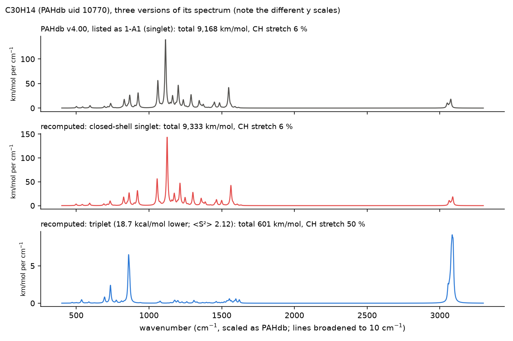

# PAHdb v4.00: 334 open-shell PAHs listed as closed-shell, with unrealistic intensities

## The issue

In the NASA Ames PAH IR Spectroscopic Database, computational version 4.00, **334 neutral PAHs (pure C/H) are listed as
singlets, although their structure cannot be closed-shell**. Their carbon framework has no Kekulé structure; for most
of them the ground state should be a triplet.

Their computed infrared spectra are clearly wrong:
- the total intensity is **5× higher than normal**: a median of 110 km/mol per carbon atom, against 23.5;
- the CH-stretch band nearly disappears: a share of 11 % of the intensity, against 41 %.

The same kind of molecule listed as a **triplet** (51 species) has normal spectra. **331 of the 334 are new in v4.00**;
v3.20 had only three such cases, and those are only mildly affected. The v4.00 paper (Ricca et al. 2026, ApJS 282, 7)
does not say how the spin states of the new species were chosen.

| Neutral PAHs (pure C/H) | v3.20 | v4.00 | Intensity per C (km/mol) | CH-stretch share |
| --- | --- | --- | --- | --- |
| Normal (Kekulé structure) | 1,251 | 1,882 | 23.5 | 41 % |
| No Kekulé structure, listed as **triplet** | 51 | 51 | 22.9 | 43 % |
| No Kekulé structure, listed as **singlet** | **3** | **334** | **110** | **11 %** |

The intensity and share columns are v4.00 medians.

**Figure 1.** Every neutral PAH in v3.20 (left) and v4.00 (right). Red points are the open-shell PAHs listed as
singlets. They are nearly absent in v3.20 and form a separate, far too intense branch in v4.00.

## Recomputing one of them confirms the cause

We recomputed C30H14 (uid 10770) at the same level and geometry as PAHdb: B3LYP/6-31G* with GPU4PySCF.
- **As a closed-shell singlet**, it reproduces PAHdb's spectrum: 9,333 against 9,168 km/mol, and the same 6 %
  CH-stretch share.
- **As a triplet**, it is **18.7 kcal/mol lower in energy** and its spectrum is normal: 601 km/mol, with a 50 %
  CH-stretch share.

The method was first checked on naphthalene and the naphthalene cation, where it matches PAHdb to within 0.5 %.

**Figure 2.** C30H14: PAHdb's listed spectrum (top), our closed-shell singlet (middle), and our triplet (bottom). Note the
different scales.

## Suggested action

Flag the 334 species, listed in `out/affected_v4.00.csv`, and recompute them in the high-spin state, as v3.20 did for its
triplets. Until then, users should exclude them from libraries and from training data.

## Reproduce

- **Database survey and Figure 1** (Python 3 with numpy and matplotlib, ~30 s). It tests each structure for a Kekulé
  structure and reads the listed spin state and intensities. N-containing PAHs are not tested.

  `python pahdb_nonkekule.py pahdb-complete-theoretical-v3.20.xml.gz pahdb-complete-theoretical-v4.00.xml.gz out`
- **Recomputation and Figure 2.** `uks_ir_test.py` (with `uks_ir.py`, our open-shell version of GPU4PySCF's analytic
  IR intensities) ran on one H100 GPU in ~10 min; result in `out/c30h14_singlet_triplet.json`. Plot it with:

  `python singlet_vs_triplet.py pahdb-complete-theoretical-v4.00.xml.gz out/c30h14_singlet_triplet.json out`
