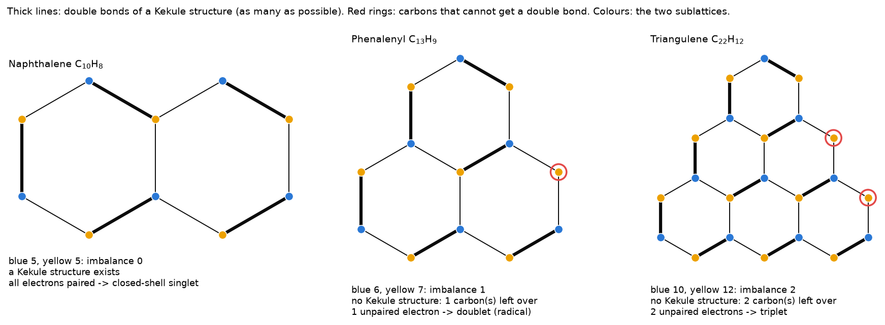
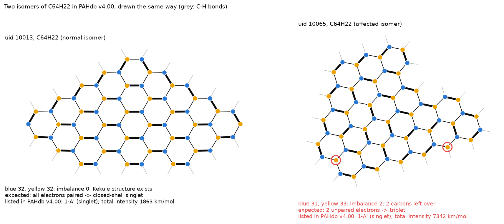

# Kekulé structures and spin states of PAHs, in brief

Figures: `out/explain1.png` and `out/explain2.png`, drawn by `kekule_explainer.py`.

## Double bonds and Kekulé structures

In a PAH, each carbon atom has four bonding electrons:
- three of them go into ordinary single bonds, to its three neighbours (C or H);
- the fourth (the π electron) must pair up with the π electron of one neighbouring carbon, forming a **double bond**.

A **Kekulé structure** is a way of drawing the molecule so that **every carbon gets exactly one double bond**. If one
exists, all π electrons are paired, and the molecule is a normal, **closed-shell** molecule. Its electronic state is a
singlet: total spin 0.

## The two-colour trick

The carbon network of a PAH made of hexagons can be coloured with two colours, blue and yellow, so that every bond
joins a blue and a yellow atom. A double bond therefore always pairs **one blue with one yellow** carbon.

- If there are as many blue as yellow carbons, a Kekulé structure usually exists. **Naphthalene:** 5 + 5, all paired.
- If one colour has more atoms, the surplus cannot be paired. Each left-over carbon carries an **unpaired electron**.
  - **Phenalenyl:** 6 blue + 7 yellow, 1 left over. One unpaired electron, a **doublet** (a radical). Every PAH with an
    odd number of hydrogens is like this.
  - **Triangulene:** 10 blue + 12 yellow, 2 left over. Two unpaired electrons, which point the same way (Lieb's theorem
    for such networks), giving a **triplet** (total spin 1).

**Figure 1.** Thick lines: as many double bonds as can be drawn. Red rings: carbons left without one. Which particular
atoms are left over depends on how the double bonds are drawn. In the real molecule, the unpaired electrons are spread
over the majority (yellow) atoms.

## What PAHdb v4.00 does wrong

Molecules like triangulene must be computed as **triplets**. PAHdb v3.20 did this for all 51 such molecules it
contained, and their spectra are normal.

In v4.00, **334 molecules of this kind are listed as singlets**, which means all electrons forced into pairs. That is
the wrong electronic state, and the computed infrared intensities come out unrealistically high: about 5× normal, with
a collapsed CH-stretch band. Figure 2 shows one real example, next to a normal isomer with the same formula.

**Figure 2.** Two C64H22 molecules from PAHdb v4.00.
- **Left:** 32 blue + 32 yellow carbons, so a Kekulé structure exists; closed-shell, correctly listed as a singlet.
- **Right:** 31 blue + 33 yellow carbons, so two are left over; it should be a triplet, but it is listed as a singlet,
  and its total intensity is 4× that of the normal isomer.

## In one sentence

A PAH whose carbons cannot all be paired by double bonds has unpaired electrons: one left over gives a radical
(doublet), two give a triplet. PAHdb v4.00 lists 334 two-left-over molecules as fully paired singlets, and their
spectra are wrong as a result.
