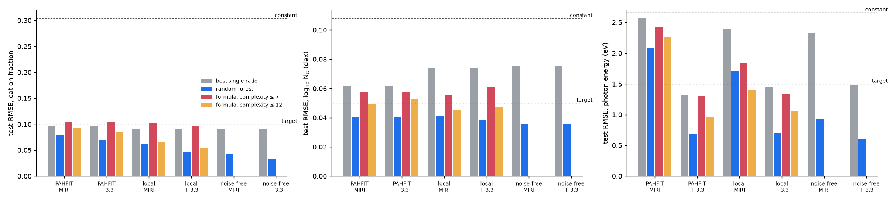
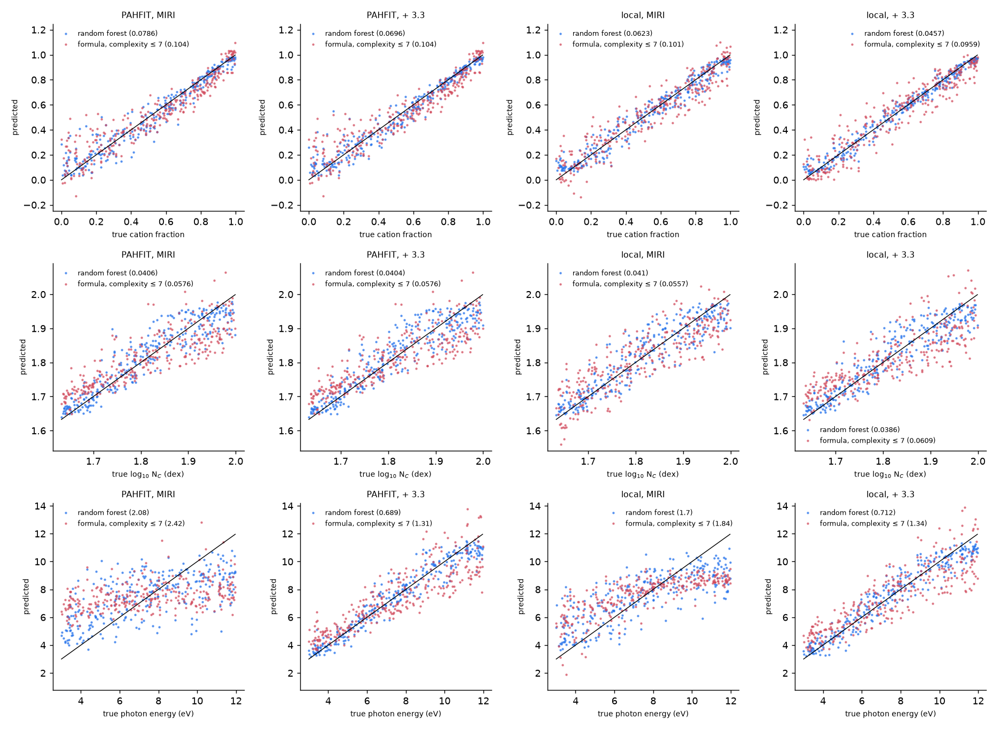
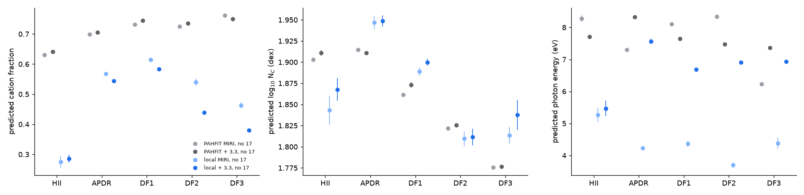
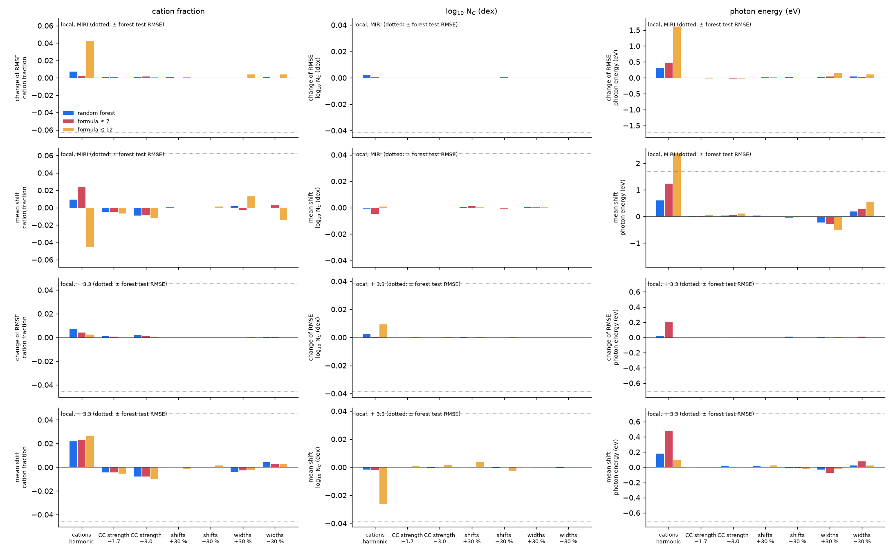

# Neutral + cation symbolic-regression prototype, version 3 (2026-11-25)

The first run of the T0b chain with cations: three targets (cation fraction f, mean size log₁₀ N_C, photon energy E),
the clean temperature rules, the Orion Bar templates, and Gate B4 step b. Requested by the coordinator (2026-11-24
17:03). Spectra and measurements ran on `gh200` (container C `5a0fd1b3…`, CPU only, 48 niced workers, 12 minutes after
a 6-minute emission run); the regression ran on `z2mini` (x86-64, PySR 2.7.2, Julia 1.13.4, scikit-learn 1.9.1; 37
minutes, no PySR crash in 108 fits).

**Status: runs end to end with `slice/run_nc_v3.sh spectra` (gh200) and `slice/run_nc_v3.sh regress` (x86-64).
The cations are PAHdb harmonic line lists with the neutral rules; the numbers are a baseline, not diagnostics.**

| Question | Answer |
| --- | --- |
| Is the cation fraction recoverable? | Yes: 0.045 with a random forest on local integrals with 3.3 µm (constant 0.304; target 0.1). A 12-node formula reaches 0.047–0.054, a single ratio 0.09 |
| Does the search rediscover an ionisation tracer? | Yes. Every short formula for f is a function of 7.7/11.2 (0.09–0.10); 6.2/11.2 alone gives 0.11 |
| Do size and photon energy survive cations? | Size: 0.039–0.041 dex (v2: 0.031–0.033). Photon energy: 0.7 eV with 3.3 µm, 1.4–2.1 eV from MIRI alone |
| Are the Orion Bar templates inside the library now? | Yes, in every ratio except 17 µm/11.2. Without that ratio all five pass the domain test. PAHFIT's 6.2/11.2 of 0.89–1.45 lies inside the training range 0.08–3.3 |
| What do the templates give? | f = 0.3–0.6 from local integrals and 0.6–0.75 from PAHFIT; N_C = 60–90; E = 5.5–8 eV with 3.3 µm. The two measurement methods differ by more than the library error: a baseline only (section 5) |
| Gate B4 step b | **Passes.** A cation CC strength slope lower by 1.7 (3.0) % per 100 K shifts f by −0.005 (−0.009) and leaves size and photon energy unchanged. Shifts ±30 %: nothing. Widths ±30 %: ±0.004 in f, ±0.2 eV in the MIRI-only photon energy (section 6) |

## 1. What changed

| Stage | Change | Script |
| --- | --- | --- |
| Rules | `d1/tdep_rules_v1_clean.csv`: refit on the 385 spin-consistent closed-shell singlets (`d1/tdep_rules_v1_clean.md`). Applied equally to neutrals and cations | `emission.py --rules` |
| Species | 819 neutrals (as v2) plus 1,567 PAHdb cations (section 2) | `nc_pool.py`, `species_nc_v1.csv` |
| Emission | Six variants that change the rules of the cations only (section 6) | `emission.py --b4` |
| Populations | Cation fraction as a hypercube axis; neutrals and cations as two sub-populations with the same size distribution and edge targets | `populations.py --design v3` |
| Measurement | Orion: NIRSpec templates for 3.3 µm; gas lines removed by a running median before local integration | `measure.py` |
| Regression | f as a target; observable sets without the 17 µm ratio; Orion predictions with Monte Carlo scatter | `regress_v2.py` |

2,000 populations, 70/15/15 split, photon energy 3–12 eV, S/N 50 at the 11.2 µm peak, three continuum shapes, as in
v2. Control tables use the 600 validation + test populations. All 2,000 + 5,555 PAHFIT fits converged (median
reduced χ² 4.5).

## 2. Species pool

`slice/species_nc_v1.csv` (3,126 rows; 2,386 used). PAHdb v4.00 holds 2,009 cations with 26–196 C.

| Cations | Count |
| --- | --- |
| **Used** | **1,567** (1,108 C/H; 459 with N) |
| Not planar (rms distance from the plane ≥ 0.05 Å; median 0.35 Å) | 295 |
| Superhydrogenated (sp³ or CH₂ carbon) | 54 |
| Listed multiplicity below the bound of `screen_spin.py` | 46 |
| Atoms other than H, C, N | 23 |
| Pentagon | 11 |
| Not screened / above the bound | 9 / 2 |
| Route line not B3LYP | 2 |

- Used cations are doublets (1,261) or closed-shell singlets (306: 254 with N, 52 C/H). All are B3LYP/6-31G* by their Gaussian route line.
- **Cations are not partners of the neutrals.** They were not matched to neutral structures; each charge state is
  its own sub-population. The neutral pool is unchanged from v2.
- N-containing cations sit in three size ranges (26–33, 52–58 and 92–104 C; 404 of the 459 in the last one). The own
  high-spin species exist only as neutrals.

## 3. Populations

A population is (1 − f) × a neutral sub-population + f × a cation sub-population, by number. Each sub-population gets
the v2 weights: the same log-normal size distribution, the same targets for the emission-weighted solo, trio and
quartet H shares, the same N fraction. f is drawn from 0–1.

| Correlation across the 2,000 populations | With log N_C | With f |
| --- | --- | --- |
| f | 0.00 | — |
| Photon energy | +0.04 | +0.04 |
| Solo / duo / trio / quartet H share | +0.03 / −0.01 / 0.00 / 0.00 | −0.01 / +0.02 / −0.02 / −0.01 |
| N-containing fraction | −0.14 | +0.01 |
| Own high-spin fraction, among neutrals | −0.02 | −0.05 |
| Own high-spin fraction, whole population | −0.02 | −0.67 |
| Continuum level / shape parameter | −0.01 / 0.00 | +0.02 / 0.00 |

- Targets are met to 0.001 (edge shares), 0.013 (N) and 0.004 (own, among neutrals). Each charge state of a population holds at
  least 288 effective species (median over populations; minimum 26).
- **Two correlations are not near zero, both by construction of the pool.** The N fraction keeps −0.14 with size, as
  in v2. The own fraction of the whole population falls with f because those species have no cations.
- The mean size of the cations is 0.002 dex above that of the neutrals (rms 0.003).
- The cation share of the 6–15 µm emission follows f (r = 0.999) and lies 0.03 above it: a molecule emits the
  energy it absorbs, whatever its charge. So f here is directly comparable with emission-weighted cation shares.
- As in v2, edge structure is independent of size between populations, not inside one.

## 4. Results

Test RMSE on 300 held-out populations. Sets: PAHFIT powers or local-continuum integrals (spline), each over the
11.2 µm band, MIRI only or with the 3.3 µm band.

| Predictor | f | log₁₀ N_C (dex) | Photon energy (eV) |
| --- | --- | --- | --- |
| Constant | 0.304 | 0.108 | 2.66 |
| **PAHFIT, MIRI:** single ratio / forest / formula ≤ 7 / ≤ 12 | 0.096 / 0.079 / 0.104 / 0.093 | 0.062 / 0.041 / 0.058 / 0.049 | 2.57 / 2.08 / 2.42 / 2.27 |
| **PAHFIT + 3.3 µm** | 0.096 / 0.070 / 0.104 / 0.085 | 0.062 / 0.040 / 0.058 / 0.053 | 1.31 / 0.69 / 1.31 / 0.96 |
| **Local, MIRI** | 0.091 / 0.062 / 0.101 / 0.065 | 0.074 / 0.041 / 0.056 / 0.045 | 2.40 / 1.70 / 1.84 / 1.41 |
| **Local + 3.3 µm** | 0.091 / 0.046 / 0.096 / 0.054 | 0.074 / 0.039 / 0.061 / 0.047 | 1.45 / 0.71 / 1.34 / 1.06 |
| Local, MIRI, without 17 µm | 0.091 / 0.061 / 0.091 / 0.067 | 0.074 / 0.042 / 0.056 / 0.046 | 2.40 / 1.43 / 1.84 / 1.43 |
| Local + 3.3 µm, without 17 µm | 0.091 / 0.045 / 0.092 / 0.047 | 0.074 / 0.039 / 0.056 / 0.046 | 1.45 / 0.74 / 1.34 / 1.06 |
| Noise-free window integrals, MIRI / + 3.3 µm (forest) | 0.043 / 0.032 | 0.036 / 0.036 | 0.93 / 0.61 |
| Target set before the run | 0.1 | 0.05 | 1.5 |

Formulas chosen on validation (r = PAHFIT ratio, s = local ratio; ln = natural logarithm):
- **f, local, ≤ 7:** f = 0.371 (ln s77 + 0.581) (0.101).
- **f, local, ≤ 12:** f = √s77 − 0.291 (1.10 s62 + s127) − 0.481 (0.065).
- **f, local + 3.3, ≤ 12:** f = 0.381 [ln(s77 / (s33 + 1.152)) − s127 + 1.491] (0.054).
- **f, local + 3.3 without 17, ≤ 12:** f = [1.089 − (s33 · s127 + 0.758) / (s77 + 0.436)]² (0.047).
- **f, PAHFIT, ≤ 7:** f = √ln(r77 + 0.963) − 0.585 (0.104).
- **Size, local, ≤ 7:** log₁₀ N_C = √(ln s127 + 4.668) − s135 (0.056).
- **Photon energy, local + 3.3, ≤ 7:** E = 6.70 s33 + s62 + 3.17 eV (1.34).
- **Photon energy, local, ≤ 12:** E = ln s127 + 42.6 s62 / (s77 + 0.343) − 10.06 eV (1.41).

What the numbers say:
- **Cation fraction.** Every predictor but the shortest formulas beats the 0.1 target. The forest on local
  integrals with 3.3 µm reaches 0.045, against 0.032 from noise-free integrals. Local integration is better than
  PAHFIT in every row (0.062 against 0.079 from MIRI alone).
- **Rediscovery.** The best single ratio is 7.7/11.2 (validation error 0.090 local, 0.100 PAHFIT), then 8.6/11.2
  (0.092 local) and 6.2/11.2 (0.114 local, 0.105 PAHFIT). No other ratio does better than 0.26 (constant 0.28).
  Every short formula for f is a monotone function of 7.7/11.2. The search finds a 6.2/11.2-type tracer, with the
  7.7 µm band in place of the 6.2 µm band.
- **The short f formulas depend on the photon energy.** Their residual correlates with E at +0.4 to +0.7 from MIRI
  alone (forests: +0.1 to +0.5): a harder photon raises the 6–9 µm bands as more cations do. The 12-node formulas
  with 3.3 µm remove it (+0.03 to +0.12); that is what the 3.3 µm term does there. The residual also correlates with
  the solo share (−0.2 to −0.5), since solo H sets the 11.2 µm denominator.
- **Size.** 0.039–0.041 dex with a forest, a quarter worse than in v2; short formulas 0.056–0.061, 12-node formulas
  0.045–0.053. Size still comes from 12.7/11.2 (forest weight 0.6–0.7), and its residual still correlates with the
  trio share (+0.5). f does not enter (residual correlation −0.08 to +0.15 for the forests).
- **Photon energy.** With 3.3 µm, 0.7 eV, as in v2. From MIRI alone it is worse than in v2 (1.4–1.7 eV local,
  2.1 eV PAHFIT; v2: 1.1 and 1.8), because the 6.2 µm band now also carries the charge. The local 12-node formula
  uses 6.2/7.7, which cancels the charge to first order.
- **17 µm.** With local integration, dropping the ratio costs nothing for f and size, and nothing for the photon
  energy once 3.3 µm is there. PAHFIT's MIRI-only photon energy needs it (2.08 → 2.55 eV without).
- Deterministic PySR runs reproduce for all 18 set–target pairs. Shuffled labels stay within 4 % of the constant
  (f: 0.266–0.271 against 0.276; size 0.107–0.110 against 0.111; E 2.45–2.54 against 2.54).

**Controls** (as v2; details in `results.json`):
- **Injection–recovery** of band/11.2 with continuum and noise, median (16–84 %): PAHFIT 6.2 µm 0.84 (0.66–1.07),
  7.7 µm 0.98 (0.78–1.27); local spline 6.2 µm 0.96 (0.87–1.04), 7.7 µm 0.94 (0.83–1.05), 3.3 µm 1.00 (0.94–1.09).
  With cations the 6–9 µm bands are strong, and PAHFIT no longer loses a third of the 6.2 µm band; its scatter is
  still twice that of local integration. Local integration recovers 0.71 of 13.5 µm and 0.44 of 17 µm.
- **Unseen continuum** (forest trained on Orion-like continua only): f from local integrals 0.079 → 0.077 (power
  law) and 0.072 (modified blackbody); from PAHFIT 0.075 → 0.077 and 0.129 (bias +0.05). Photon energy from PAHFIT,
  MIRI only: 1.84 → 2.29 and 2.81 eV (bias −1.0 and −1.2); from local integrals 2.04 → 1.94 and 1.92.

## 5. Orion Bar templates

Five PDRs4All templates: MIRI MRS (Chown et al. 2024, CDS J/A+A/685/A75) and, new here, NIRSpec G395H for 3.3 µm
(Peeters et al. 2024, J/A+A/685/A74). 30 Monte Carlo refits per template (1 % noise for MIRI, the listed errors for
NIRSpec).

**Domain.** Distance to the fifth nearest training point, in units of the training scatter, against the 99th
percentile of the training set:

| Set | HII | APDR | DF1 | DF2 | DF3 | Threshold |
| --- | --- | --- | --- | --- | --- | --- |
| Local, MIRI, all seven ratios | 9.6 | 2.7 | 0.8 | 1.4 | 2.6 | 2.4 |
| PAHFIT, MIRI, all seven ratios | 24 | 11 | 7.5 | 9.8 | 15 | 2.7 |
| Local, MIRI, without 17 µm | 0.6 | 0.5 | 0.5 | 0.7 | 0.8 | 2.0 |
| Local + 3.3 µm, without 17 µm | 0.9 | 0.6 | 0.7 | 0.8 | 1.1 | 2.1 |
| PAHFIT, MIRI, without 17 µm | 0.7 | 0.8 | 0.8 | 0.9 | 1.1 | 2.3 |
| PAHFIT + 3.3 µm, without 17 µm | 0.9 | 0.9 | 0.9 | 1.1 | 1.4 | 2.5 |

- **With cations the templates are inside the library, except in 17 µm/11.2.** PAHFIT's 6.2/11.2 is 0.89–1.45 and
  7.7/11.2 is 2.8–4.6; the training set spans 0.08–3.3 and 0.4–12.6 (1st–99th percentile; medians 0.23 and 2.35 for
  6.2/11.2 at f < 0.1 and f > 0.9). In v1 and v2 the neutral library stopped at 0.34.
- The 17 µm ratio is outside for every template with PAHFIT (0.95–1.74 against a training range of 0.03–0.31) and
  for three with local integration (zero or negative). The library has little emission there, and the templates have a
  steep continuum and the H₂ S(1) line. The sets without that ratio are used below.

**Baseline estimates** (random forest; ± is the Monte Carlo scatter, at most 0.02 in f, 0.02 dex and 0.24 eV):

| Template | Local + 3.3 µm: f / N_C / E (eV) | PAHFIT + 3.3 µm: f / N_C / E (eV) | Local, MIRI: f / N_C | PAHFIT, MIRI: f / N_C |
| --- | --- | --- | --- | --- |
| HII | 0.29 / 74 / 5.5 | 0.64 / 81 / 7.7 | 0.28 / 70 | 0.63 / 80 |
| APDR | 0.54 / 89 / 7.6 | 0.71 / 81 / 8.3 | 0.57 / 89 | 0.70 / 82 |
| DF1 | 0.58 / 79 / 6.7 | 0.75 / 75 / 7.7 | 0.62 / 77 | 0.73 / 73 |
| DF2 | 0.44 / 65 / 6.9 | 0.74 / 67 / 7.5 | 0.54 / 64 | 0.73 / 66 |
| DF3 | 0.38 / 69 / 6.9 | 0.75 / 60 / 7.4 | 0.46 / 65 | 0.76 / 60 |

- **The two measurement methods disagree on f by 0.15–0.37**, ten times the Monte Carlo scatter and several times the
  library error (0.05–0.08). In the library PAHFIT and local integration give the same 7.7/11.2 on average (recovery
  0.98 and 0.94). In the templates PAHFIT gives 2.8–4.6 and local integration 1.5–2.4. The templates have broad
  emission under the 6–9 and 10–15 µm bands that the library spectra lack: PAHFIT's wide profiles count it as band,
  and the local continuum counts the 10–15 µm part into the 11.2 µm band. **Until the library reproduces that
  emission, f for real spectra is uncertain by about ±0.15, whatever the formal error.**
- **Comparison.** Ricca et al. (2025, Table 3) fit the atomic PDR with PAHdb v4.00 and find 65 % of the 6–15 µm
  emission from cations and a mean N_C of 76 ± 37, with 8 eV photons assumed. This run gives f = 0.54 (local) to
  0.71 (PAHFIT), N_C = 81–89 and E = 7.6–8.3 eV for the same template.
- **Order of the templates** (reported, not a gate): PAHFIT puts f lowest in the H II region and highest in DF3,
  following its 6.2/11.2 (Chown et al. 2024, section 4.3). Local integration puts f highest in DF1 and the atomic
  PDR and lower towards DF3. Both put the smallest PAHs in DF2 and DF3.
- The 12-node formula for f (local + 3.3 µm, without 17 µm) gives 0.38 / 0.52 / 0.58 / 0.47 / 0.42, close to the
  forest.
- Not removed from the templates: the 3.4 µm aliphatic band, whose blue side lies inside the 3.3 µm window.

## 6. Gate B4 step b: how much do the cation rules matter?

Predictors trained on the baseline (clean neutral rules for both charge states) were applied to the same 600
held-out populations with only the cation rules changed, at S/N 50, same noise draws. Shift = mean change of the
prediction; ΔRMSE = change of the error against the truth. Random forest on local integrals, MIRI only / with 3.3 µm:

| Cation rules changed | f: shift | f: ΔRMSE | log₁₀ N_C: shift (dex) | E: shift (eV) | E: ΔRMSE (eV) |
| --- | --- | --- | --- | --- | --- |
| CC strength slope −1.7 % per 100 K | −0.005 / −0.004 | +0.001 / +0.001 | 0.000 / 0.000 | +0.01 / +0.01 | −0.00 / −0.01 |
| CC strength slope −3.0 % per 100 K | −0.009 / −0.008 | +0.001 / +0.002 | 0.000 / 0.000 | +0.03 / +0.01 | −0.01 / −0.01 |
| Position slopes +30 % | 0.000 / 0.000 | 0.000 / 0.000 | 0.000 / 0.000 | +0.03 / +0.02 | +0.01 / 0.00 |
| Position slopes −30 % | 0.000 / 0.000 | 0.000 / 0.000 | 0.000 / 0.000 | −0.05 / −0.02 | +0.01 / +0.01 |
| Width growth +30 % | +0.002 / −0.004 | 0.000 / 0.000 | 0.000 / 0.000 | −0.23 / −0.03 | +0.02 / +0.01 |
| Width growth −30 % | −0.001 / +0.004 | +0.001 / 0.000 | 0.000 / 0.000 | +0.18 / +0.03 | +0.04 / −0.00 |
| Cations harmonic (no rules, 15 cm⁻¹ Gaussians) | +0.009 / +0.022 | +0.007 / +0.007 | −0.001 / −0.002 | +0.60 / +0.18 | +0.31 / +0.02 |
| Baseline RMSE on these rows | 0.062 / 0.045 | | 0.041 / 0.037 | 1.66 / 0.71 | |

"CC strength slope" is the strength rule of the lines in the 6.2, 7.7 and 8.6 µm features (1100–1700 cm⁻¹): −1.7 is
the cloud-aimd cation − neutral value, −3.0 its 95 % bound. Size shifts are below 0.0005 dex wherever the table
says 0.000. Every set and predictor is in `results.json` under `sets.<set>.targets.<target>.control_<variant>` (`cc17`, `cc30`, `shp30`, `shm30`, `wdp30`, `wdm30`, `harmq`; `harm`
makes both charge states harmonic).

- **CC strength.** f falls by 0.003 for every 1 % per 100 K by which the cation CC bands weaken faster than the
  neutral ones (0.0030 MIRI only, 0.0026 with 3.3 µm; linear between the two points). The formulas and PAHFIT give
  the same (−0.004 to −0.007 at 1.7; −0.007 to −0.012 at 3.0). Size does not move (below 0.0005 dex for the forests,
  0.0014 for one formula). Photon energy moves by at most 0.04 eV for the forests and 0.11 eV for the MIRI-only
  12-node formula.
- **Positions.** ±30 % changes nothing in f with local integration (below 0.002, formulas included), because a band
  window is wider than the shift. PAHFIT's f moves by ∓0.012 (forest) and ∓0.007 to ∓0.010 (formulas).
- **Widths.** ±30 % moves f by 0.001–0.004 (forest). One 12-node formula is more exposed: local MIRI-only, ±0.013.
  The MIRI-only photon energy is the sensitive quantity: ∓0.2 eV for the forest and ∓0.5 eV for the 12-node formula.
  With 3.3 µm it is ∓0.03 eV (short formula ∓0.08).
- **No rules for cations.** Harmonic cations next to finite-temperature neutrals shift f by +0.01 to +0.02 with local
  integration and by +0.07 with PAHFIT (ΔRMSE +0.022 on 0.083), and the photon energy by +0.2 to +0.6 eV (forest)
  and +1.2 to +2.4 eV (MIRI-only formulas). The MIRI-only 12-node f formula moves by −0.045.

**Conclusion for Gate B4.** Applying the neutral rules to cations is good enough for these three diagnostics.
- **Accuracy bar for the D1 cation rules,** set at a bias of 0.01 in f (a fifth of the best forest error) and 0.1 eV
  in the photon energy with 3.3 µm:

| Rule | Needed | Status |
| --- | --- | --- |
| CC strength slope, cation − neutral | ± 3 % per 100 K | Met: cloud-aimd gives −1.5 ± 1.8 (naphthalene) |
| Position slopes | ± 30 % is more than enough with local integration | Met by the xTB test (cations within a few cm⁻¹ of neutrals; `tdep_rules_v1.md`) |
| Width growth | ± 30 % for f and for E with 3.3 µm; ± 15 % if the MIRI-only photon energy is to hold to 0.1 eV | xTB test only; not measured with MLMD or AIMD |
| Finite-temperature rules at all | Required: without them f is off by 0.01–0.07 and E by 0.2–2.4 eV | Neutral rules in use |

- So the cation MLMD does not need to beat the neutral rules by much. Its value is a check of the width growth
  and of the strength slope for larger cations than naphthalene.
- **Not tested:** strength changes that differ between the 6.2, 7.7 and 8.6 µm bands, changes of the out-of-plane
  rules for cations, and combined changes. Each case above changes one thing.

## 7. Problems and what is left

1. **Real spectra against the library.** The two measurement methods disagree on the Orion templates by 0.15–0.37 in
   f (section 5). The library needs the broad 6–9 and 10–15 µm emission, or the measurement must be defined so that
   it does not matter. This limits any application more than the B4 uncertainties do.
2. **Cations are harmonic PAHdb line lists.** Their band strengths carry PAHdb's errors for open-shell species, and
   no cation is paired with its neutral, so charge and structure are mixed only at population level.
3. **17 µm.** The library has too little 15–18 µm emission; the ratio is dropped for Orion.
4. **f depends on the photon energy without 3.3 µm** (section 4). A MIRI-only f needs an independent radiation
   field or accepts 0.06–0.10.
5. **Pool limits carried over from v2:** edge structure tied to size inside populations; N fraction −0.14 with size;
   own high-spin species only as neutrals.
6. **Rules:** the per-line widths were not refitted (`tdep_rules_v1_clean.md`).
7. **Not done:** Monte Carlo refits of the synthetic spectra; the analytic-endpoint control was not repeated with
   the clean rules (v2: passes with local integration); single-HDF5 provenance.
8. **Regression environment.** Each `uv run` used to download Julia again (290 MB); `run_nc_v3.sh` now sets
   `PYTHON_JULIAPKG_PROJECT` to a fixed directory.

## Files

`results.json` (every number above: `sets.<set>.targets.<target>`; sets `P`, `P33`, `L`, `L33`, their `…n` versions
without 17 µm, `LL`, `T`, `…x`), `features.csv` (labels and ratios of the 2,000 populations), `pred_*.csv`,
`fronts/front_*.csv` (PySR fronts), `figs/`, `provenance.txt`. Intermediate files, not archived (myhub is offline):
`gh200:/var/tmp/jjlee-pah/sr_proto/out_v3/` (`emission_v3.h5` 3.2 GB, `pop_v3.h5`, `feat_*.csv`, `spectra.log`) and
`z2mini:/var/tmp/jjlee-pah/sr_v3/` (the tables and `reg_v3/`).
