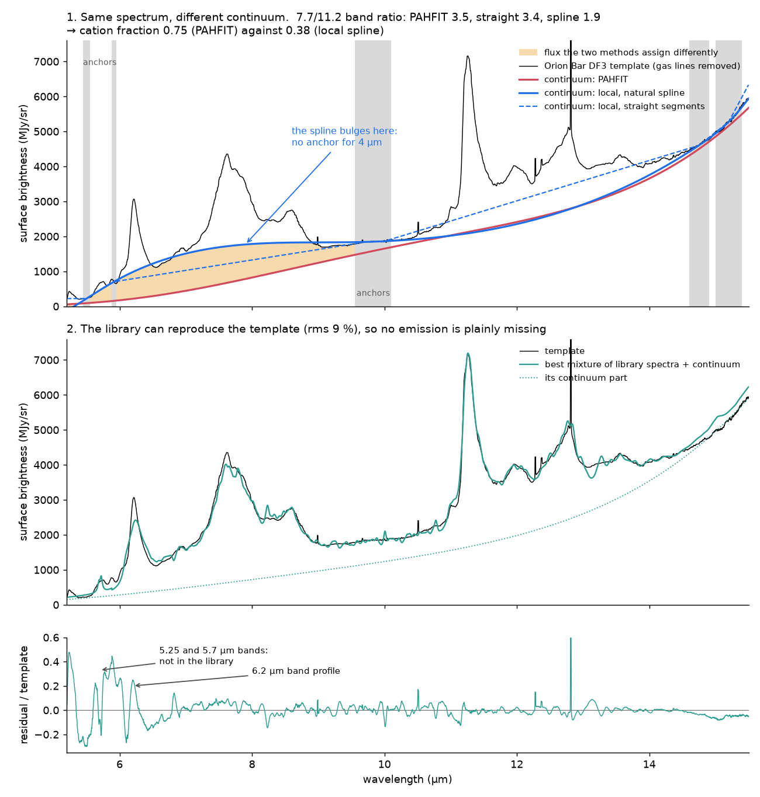
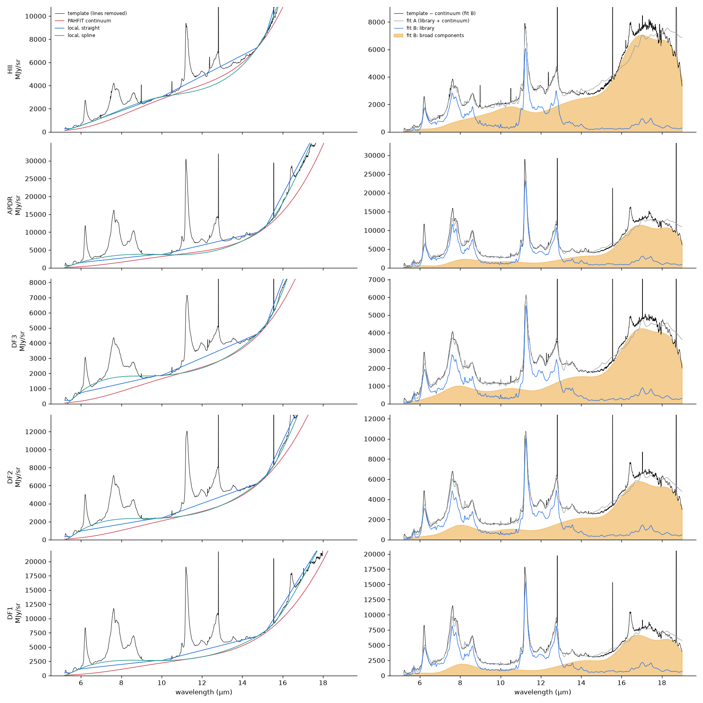

# Neutral + cation prototype, version 4: Orion gap diagnosis and preparation (2026-11-25)

Requested by the coordinator (shared notes, 2026-11-25 20:10). Follows `reports/nc_sr_v3/README.md`. Spectra and
measurements ran on gh200 (container C, CPU only, 48 niced workers, 26 minutes); the regression ran on z2mini.
Driver: `slice/run_nc_v4.sh`. Diagnosis: `slice/orion_gap.py`.

## Summary

| Question | Answer |
| --- | --- |
| Why do PAHFIT and local integration disagree on the Orion templates? | They put the continuum under the 6–9 µm bands at different levels. At 7.7 µm PAHFIT's continuum is 0.10–0.34 of the flux, the local one 0.20–0.47. PAHFIT therefore measures 1.3–2.3 times more in 6.2, 7.7 and 8.6 µm than local integration, and the same in 11.2 µm. In the library the two agree in every band (median ratio 0.9–1.2) |
| Is emission missing from the library? | Not in a way a fit can show. A free mixture of library spectra plus PAHFIT's continuum basis reproduces every template to 8–10 % (rms), 5–9 % in 7–9 µm. Broad extra components improve this by 1 % and take over half of the continuum: they cannot be told apart from continuum |
| Does plateau emission in the training spectra close the gap? | No. With three broad Gaussians added (6–9, 10–15, 15–18 µm) the gap grows from 0.16–0.37 to 0.24–0.56, and the error on the library grows by a third to a half |
| Do band wings close it? | No. With up to half of each band moved into Lorentzian wings, the estimates move by at most 0.05 and the gap stays 0.18–0.41 |
| What reduces it? | A local continuum that cannot overshoot. The natural spline bulges under the 6–9 µm bands of the templates. With a monotone piecewise-cubic continuum (new, `Lpch`) the gap is 0.09–0.21 without 3.3 µm and 0.13–0.31 with it; with straight segments 0.02–0.22 and 0.09–0.28 |
| Which method is more likely right? | Not settled. The few library spectra that show the Orion pattern have continua outside PAHFIT's basis, which suggests that PAHFIT overestimates the 6–9 µm bands there. This is an indication, not a test |
| Why is 17 µm/11.2 outside the library? | The 15–19 µm dust continuum of the templates is 1.1–3.0 times the 11.2 µm peak and curved. PAHFIT's continuum reaches 0.83 of it and its wide 17 µm features take the rest (0.6–1.4 of the 11.2 µm band). A local chord lies above the curve, so the local integral is zero or negative. The 16.4 µm band itself is 0.05–0.07 of 11.2 µm |
| Clean per-line widths | `d1/perline_widths_v2_clean.csv`. No value moves by more than 8 % |
| Endpoint control with the clean tables | Unchanged from v2: local integration recovers f to 0.012 without noise; PAHFIT does not for small PAHs |
| Monte Carlo error bars at S/N 50 | f ± 0.02–0.03, size ± 0.005–0.011 dex, photon energy ± 0.2–0.5 eV. Noise is a quarter to two thirds of the test error of f |
| Cation rules | `emission.py --rules-cation` and `--widths-cation` are in place and tested; `RULES_CATION=… slice/run_nc_v4.sh spectra` uses them |

**Consequence.** The uncertainty of f for real spectra stays at about ±0.15, from the continuum under the 6–9 µm
bands. A nuisance component in the training spectra does not remove it. Section 7 lists what could.

## 1. What changed against v3

| Stage | Change | Code |
| --- | --- | --- |
| Rules | clean per-line widths next to the clean rules | `d1/perline_widths_clean.py`, `emission.py --widths` |
| Cation rules | separate tables for charged species; a missing row falls back to the neutral value | `emission.py --rules-cation`, `--widths-cation` |
| Measurement | third local continuum (monotone piecewise cubic, `Lpch_*`); plateau and wing nuisance; S/N and noise seed; test-only pick | `measure.py --plateau`, `--wings`, `--snr`, `--seed`, `--pick test` |
| Regression | sets for the new continuum (`H…`) and for straight segments without 17 µm (`LLn`, `LL33n`); Monte Carlo error bars | `regress_v2.py --mc` |
| Diagnosis | continuum levels and library mixtures per template | `orion_gap.py` |

The species pool, the population design and the B4 result are those of v3. With the clean widths the library
results change in the third decimal (forest, local + 3.3 µm: f 0.045, size 0.039 dex, energy 0.74 eV).

## 2. The Orion gap

### 2.1 Where the two methods differ

Ratio of PAHFIT's band integral to the local integral, same window (library: 1st / 50th / 99th percentile):

| Band | Library, spline | HII | APDR | DF1 | DF2 | DF3 | Library, monotone | Templates, monotone |
| --- | --- | --- | --- | --- | --- | --- | --- | --- |
| 6.2 | 0.45 / 0.89 / 1.72 | 1.34 | 1.32 | 1.51 | 1.92 | 2.33 | 0.44 / 0.88 / 1.43 | 1.24–1.87 |
| 7.7 | 0.68 / 1.08 / 1.94 | 1.44 | 1.38 | 1.41 | 1.61 | 1.85 | 0.68 / 1.06 / 1.40 | 1.28–1.51 |
| 8.6 | 0.92 / 1.16 / 2.27 | 1.80 | 1.42 | 1.45 | 1.73 | 2.28 | 0.94 / 1.14 / 1.67 | 1.34–1.85 |
| 11.2 | 0.69 / 1.04 / 1.27 | 0.88 | 0.88 | 0.92 | 0.92 | 0.93 | 0.71 / 1.07 / 1.32 | 0.93–1.01 |
| 12.7 | 0.80 / 1.07 / 1.70 | 0.61 | 0.82 | 0.92 | 0.89 | 0.87 | 0.91 / 1.14 / 2.68 | 0.86–1.00 |

- Each template value is inside the library range. The combination is not: 4 of 2,000 library spectra have all of
  6.2, 7.7 and 8.6 µm high with 11.2 µm normal (monotone continuum).
- The 7.7/11.2 ratio follows: 2.5–3.7 with PAHFIT, 1.5–2.4 with the spline, 2.4–3.5 with straight segments.

Continuum level as a fraction of the template flux (`orion_gap.py`):

| Template | At 7.7 µm: PAHFIT / straight / spline | At 11.25 µm | At 17 µm |
| --- | --- | --- | --- |
| HII | 0.34 / 0.45 / 0.47 | 0.40 / 0.45 / 0.37 | 0.83 / 1.05 / 1.05 |
| APDR | 0.11 / 0.20 / 0.27 | 0.15 / 0.20 / 0.14 | 0.81 / 1.08 / 1.02 |
| DF1 | 0.10 / 0.20 / 0.28 | 0.16 / 0.21 / 0.16 | 0.83 / 1.04 / 0.99 |
| DF2 | 0.15 / 0.27 / 0.37 | 0.23 / 0.28 / 0.22 | 0.84 / 1.03 / 1.00 |
| DF3 | 0.18 / 0.32 / 0.44 | 0.30 / 0.36 / 0.29 | 0.83 / 1.03 / 1.00 |

One template in detail (DF3, where the methods differ most; `slice/figure_df3.py`):

- The shaded flux is band for PAHFIT and continuum for the spline. At 11.2 µm the two continua coincide, so only
  the numerator of 7.7/11.2 changes: 3.5 with PAHFIT, 3.4 with straight segments, 1.9 with the spline.
- The library mixture of section 2.2 puts its continuum higher than PAHFIT's: a third level for the same spectrum.

All five templates:

- **Left panels:** the natural spline rises into a hump between its anchors at 5.9 and 9.7 µm, most in DF3 and DF2.
  The anchors are 4 µm apart and the continuum turns steep beyond 15 µm. That hump removes band flux.
- PAHFIT's continuum runs below both local continua from 5 to 10 µm. The flux between them is 0.26–0.35 of the
  11.2 µm band in 9.0–10.5 µm and 0.40–0.67 in 5.2–6.0 µm, where no strong band lies. PAHFIT gives it to dust
  features; local integration calls it continuum.
- This is the known difference between decomposition and spline methods: Smith et al. (2007, section 5.3) find
  a factor of about 1.75 for 6.2 and 11.3 µm and more for 7.7 and 8.6 µm. The library spectra do not show it.

### 2.2 Library mixtures (right panels)

Non-negative fit of each template (5.2–19 µm, gas lines removed) with 4,772 library spectra (2,386 species at 6 and
10 eV) plus PAHFIT's continuum basis (fit A), and with 17 broad Gaussians added (fit B).

| Template | Fit A: rms of the relative residual | Fit B | Residual of fit A in 5.2–6.0 / 6.0–6.6 / 7.0–9.0 µm (share of the flux) |
| --- | --- | --- | --- |
| HII | 0.081 | 0.070 | +0.05 / +0.04 / +0.03 |
| APDR | 0.102 | 0.093 | +0.12 / +0.11 / +0.06 |
| DF1 | 0.100 | 0.093 | +0.13 / +0.08 / +0.06 |
| DF2 | 0.091 | 0.085 | +0.14 / +0.03 / +0.04 |
| DF3 | 0.089 | 0.082 | +0.15 / +0.01 / +0.02 |

- **The library with a continuum fits the templates.** What it lacks is at 5.2–6.0 µm (12–15 % of the flux; the
  5.25 and 5.7 µm bands are combination bands, absent from harmonic line lists) and the profile of the 6.2 µm band
  in the atomic PDR and DF1.
- **Broad components are not identifiable.** In fit B they take 0.11–0.53 of the flux in every window, also
  between the bands, and the continuum drops by the same amount. The fit improves by 0.01. Their size is an upper
  limit: peak 0.10–0.18 of the library's 11.2 µm peak at 6–9 µm, 0.13–0.39 at 10–15 µm, 0.43–1.16 at 15–18 µm.
- The cations carry 0.35–0.46 of the library flux in fit A and 0.29–0.39 in fit B. This is an emission share,
  not the number fraction f.

### 2.3 Nuisance emission in the training spectra

Forest for f on the Orion templates, sets without 17 µm. "Gap" is the PAHFIT value minus the local value, lowest and
highest of the five templates.

| Trained on | Method | HII | APDR | DF1 | DF2 | DF3 | Gap to PAHFIT | Test RMSE of f |
| --- | --- | --- | --- | --- | --- | --- | --- | --- |
| No nuisance, + 3.3 µm | PAHFIT | 0.64 | 0.70 | 0.74 | 0.73 | 0.75 | | 0.072 |
| | Local, spline | 0.28 | 0.54 | 0.58 | 0.44 | 0.38 | 0.16–0.37 | 0.045 |
| | Local, monotone | 0.37 | 0.57 | 0.61 | 0.51 | 0.44 | 0.13–0.31 | 0.049 |
| | Local, straight | 0.36 | 0.52 | 0.65 | 0.56 | 0.58 | 0.09–0.28 | 0.063 |
| No nuisance, MIRI only | PAHFIT | 0.59 | 0.69 | 0.73 | 0.73 | 0.75 | | 0.083 |
| | Local, spline | 0.29 | 0.56 | 0.62 | 0.53 | 0.46 | 0.11–0.30 | 0.061 |
| | Local, monotone | 0.38 | 0.61 | 0.64 | 0.61 | 0.58 | 0.08–0.21 | 0.065 |
| | Local, straight | 0.37 | 0.60 | 0.71 | 0.69 | 0.69 | 0.02–0.22 | 0.079 |
| Plateaus, + 3.3 µm | PAHFIT | 0.66 | 0.74 | 0.77 | 0.77 | 0.80 | | 0.096 |
| | Local, spline | 0.27 | 0.48 | 0.53 | 0.31 | 0.24 | 0.24–0.56 | 0.066 |
| | Local, monotone | 0.28 | 0.43 | 0.54 | 0.41 | 0.42 | 0.23–0.38 | 0.075 |
| Wings, + 3.3 µm | PAHFIT | 0.61 | 0.68 | 0.73 | 0.72 | 0.74 | | 0.065 |
| | Local, spline | 0.26 | 0.47 | 0.55 | 0.41 | 0.33 | 0.18–0.41 | 0.044 |
| | Local, monotone | 0.32 | 0.52 | 0.55 | 0.47 | 0.45 | 0.16–0.29 | 0.051 |

- **Plateaus** (`measure.py --plateau`): three Gaussians per spectrum, centres 7.7, 12.3 and 17.0 µm, FWHM 2–4,
  2.5–5 and 1.5–3 µm, peak uniform from zero to 0.25, 0.5 and 1.5 of the 11.2 µm peak (1.3 times the limits of
  section 2.2). PAHFIT's f rises and the local f falls. The library ratio of PAHFIT to local stays near 1, so the
  component does not produce the Orion pattern. Predictors trained without plateaus lose 0.04–0.05 in f when
  plateaus are present; this is the size of the risk if such emission exists.
- **Wings** (`measure.py --wings`): a share of 0–0.5 of every band in a Lorentzian of 40–160 cm⁻¹. No cost on the
  library, no change of the pattern. Wings raise the anchors and the bands alike.
- **Library spectra that do show the pattern** (PAHFIT high in 6.2, 7.7, 8.6 µm; monotone continuum): 36 of 2,000
  without nuisance. 32 of them have a power-law or single-blackbody continuum, which PAHFIT's basis cannot follow,
  and their median f is 0.12. Their PAHFIT bands are inflated by continuum. If the templates are such a case,
  PAHFIT's f of 0.6–0.75 is too high. The test is a fit of the templates with a freer continuum (section 7).

### 2.4 The 17 µm ratio

| | HII | APDR | DF1 | DF2 | DF3 | Library (1st–99th percentile) |
| --- | --- | --- | --- | --- | --- | --- |
| 17/11.2, PAHFIT | 1.40 | 0.77 | 0.62 | 0.71 | 0.92 | 0.04–0.28 |
| 17/11.2, local spline | −0.35 | −0.03 | 0.06 | 0.01 | −0.05 | −0.03–0.17 |
| Continuum at 17 µm / 11.2 µm peak | 3.0 | 1.1 | 1.1 | 1.6 | 2.2 | |
| Chord minus flux at 17 µm / 11.2 µm peak | 0.14 | 0.08 | 0.04 | 0.05 | 0.07 | |
| 16.4 µm band / 11.2 µm band (local, narrow) | 0.064 | 0.063 | 0.074 | 0.060 | 0.046 | |

- The library's true 17/11.2 is 0.14–0.34 (median 0.21). The templates do not show more 15–18 µm band emission
  than the library; the v3 report said the library has too little, which was wrong.
- Both methods fail on the continuum. PAHFIT's fixed-temperature blackbodies reach 0.81–0.84 of the flux at
  17 µm, and its 17 µm features take the rest. The local chord from 15.2 to 18.85 µm lies above a convex
  continuum, by 0.04–0.14 of the 11.2 µm peak over a 1.9 µm window, which outweighs the band.
- A 17 µm measurement for such spectra needs a local continuum over 15.5–18 µm with curvature, or the 16.4 µm band
  alone. Until then the ratio stays out of the Orion sets. Dropping it costs nothing for f and size (v3).

## 3. Clean per-line widths

`d1/perline_widths_v2_clean.csv`, documented in `d1/tdep_rules_v1_clean.md` (table 2). The script reproduces
version 2 when run on all species.

| Line family | FWHM at 300 K (cm⁻¹) | Growth per 100 K | Version 2 |
| --- | --- | --- | --- |
| CH stretch | 10.57 | 5.86 | 10.6, 5.9 (the 60 species were already clean) |
| CC stretch (6.2 µm) | 14.17 | 8.96 | 14.3, 9.3 |
| 1470–1540 cm⁻¹ | 7.42 | 2.03 | 7.4, 2.1 |
| CC/CH in-plane (7.7 µm) | 5.45 | 1.65 | 5.9, 1.75 |
| CH in-plane (8.6 µm) | 5.50 | 2.38 | 6.0, 2.5 |
| CH out-of-plane | 4.69 | 0.64 | 4.5, 0.67 |

The empirical 6.2 µm term is +5.58 on the 57 clean species of the version-2 sample and +4.27 on 60 others; the
table takes the pooled +5.26. The 7.7 µm width growth is still not closed.

## 4. Analytic-endpoint control (plan 5.9, control 2) with the clean tables

25 neutral/cation pairs, f on a grid at three sizes, f recovered from one band ratio and the endpoint strengths.
Error of f, rms / largest (`endpoint.json`):

| Spectra | PAHFIT 6.2 | PAHFIT 7.7 | Local 6.2 | Local 7.7 |
| --- | --- | --- | --- | --- |
| Harmonic, no noise | 0.005–0.025 / 0.034 | 0.011–0.052 / 0.106 | 0.002–0.004 / 0.006 | 0.003–0.006 / 0.009 |
| Rules, no noise | 0.014–0.160 / 0.308 | 0.029–0.153 / 0.282 | 0.002–0.006 / 0.008 | 0.003–0.009 / 0.012 |
| Rules, continuum and noise | 0.111–0.183 / 0.395 | 0.051–0.076 / 0.173 | 0.040–0.054 / 0.124 | 0.043–0.051 / 0.141 |

- **Passes for local integration**, as in v2 (largest error without noise 0.012; v2: 0.009).
- PAHFIT fails for the smallest size (N_C 30) with the rules, as in v2 (0.16 against 0.12).
- With noise one ratio gives f to 0.04–0.05 for local integration.

## 5. Monte Carlo error bars

The 300 test populations, ten more noise draws at each S/N (per pixel at the 11.2 µm peak). The table gives the
scatter of the forest's prediction between draws (rms over populations) and, in brackets, the test RMSE.

| Set | S/N | f | log₁₀ N_C (dex) | Photon energy (eV) |
| --- | --- | --- | --- | --- |
| PAHFIT + 3.3 µm | 20 | 0.028 (0.072) | 0.011 (0.041) | 0.49 (0.80) |
| | 50 | 0.020 (0.072) | 0.007 (0.041) | 0.24 (0.68) |
| | 100 | 0.017 (0.071) | 0.006 (0.041) | 0.16 (0.66) |
| Local spline + 3.3 µm | 20 | 0.063 (0.072) | 0.018 (0.041) | 0.59 (0.91) |
| | 50 | 0.029 (0.044) | 0.010 (0.039) | 0.28 (0.75) |
| | 100 | 0.017 (0.039) | 0.006 (0.038) | 0.16 (0.74) |
| Local monotone + 3.3 µm | 20 | 0.046 (0.064) | 0.013 (0.044) | 0.53 (0.91) |
| | 50 | 0.024 (0.049) | 0.007 (0.044) | 0.26 (0.80) |
| | 100 | 0.013 (0.045) | 0.005 (0.044) | 0.15 (0.79) |
| Local straight + 3.3 µm | 50 | 0.011 (0.063) | 0.005 (0.044) | 0.21 (0.86) |
| Local spline, MIRI only | 50 | 0.033 (0.060) | 0.011 (0.041) | 0.53 (1.41) |
| PAHFIT, MIRI only | 50 | 0.021 (0.083) | 0.008 (0.041) | 0.28 (2.55) |

- **Size is not limited by noise** at any S/N here (0.005–0.02 dex against 0.04).
- **f with the spline continuum is noise-limited below S/N 50**: 0.063 of 0.072 at S/N 20. The spline amplifies
  noise in the anchors (scatter of ln ratio at S/N 50: 0.044–0.056 for the 6–9 µm bands, against 0.036–0.042
  monotone, 0.010–0.019 straight, 0.010–0.018 PAHFIT).
- The monotone continuum is the best compromise below S/N 50; the spline wins at S/N 100.
- PAHFIT's error is model error, not noise: it does not improve with S/N.
- 12-node formulas for the monotone set with 3.3 µm: f 0.067, size 0.055 dex, energy 1.06 eV; noise scatter 0.025,
  0.005 dex and 0.20 eV at S/N 50. All deterministic PySR repeats reproduce; no crash in 36 fits.

## 6. Cation rules: ready

- `slice/emission.py --rules-cation <csv> [--widths-cation <csv>]` applies a separate table to species with
  charge. Columns as `d1/tdep_rules_v1_clean.csv` and `d1/perline_widths_v2_clean.csv`. A (band, quantity) row or
  a line family that the cation table lacks takes the neutral value, and the log lists them.
- Test: a cation table that lowers the CC strength slope by 1.7 % per 100 K gives the same spectrum as the built-in
  `cc17` variant of v3 (difference 0), and neutrals are unchanged.
- To run: `RULES_CATION=/r/d1/tdep_rules_cation_v1.csv slice/run_nc_v4.sh spectra` on gh200, then
  `slice/run_nc_v4.sh regress <tables>` on z2mini. About 30 and 20 minutes.
- The B4 variants (`--b4`) still apply on top of whichever table the charged species use.

## 7. What is left

1. **Continuum under the 6–9 µm bands of real spectra.** Not resolved by nuisance emission. Options, in order of
   cost:
   - Fit the templates with PAHFIT and a freer continuum (more temperatures, or a spline term). If its 6–9 µm
     bands fall towards the local values, PAHFIT's f is the biased one.
   - Train and apply with one continuum definition that both worlds share: local anchors next to each band
     (6.6–7.0 and 9.1–9.4 µm, as Chown et al. 2024, appendix C), accepting 10 % library emission in them.
   - Give the library the emission that fills 5–10 µm in real spectra. Its origin is not in the harmonic line
     lists (combination bands, very wide wings, or small grains), so this needs a physical model, not a nuisance.
2. **17 µm:** a curved local continuum over 15.5–18 µm, or the 16.4 µm band alone.
3. **Local continuum choice:** the monotone continuum should replace the spline as the default for real spectra.
   Formulas exist for it (`fronts/`); the v3 formulas were found on spline integrals.
4. **Cation rules:** waiting for `d1/tdep_rules_cation_v1.csv`.
5. Carried over from v3: cations unpaired and harmonic; edge structure tied to size inside populations; f depends
   on the photon energy without 3.3 µm.

## Files

- `results_base.json`, `results_plat.json`, `results_wing.json`: `regress_v2.py` output for the three training
  tables. `control_plat`, `control_wing`, `control_noplat`, `control_nowing`: each predictor on the other table.
  `mc_s20`, `mc_s50`, `mc_s100`: Monte Carlo. `orion`: template predictions.
- `features_base.csv`: labels and ratios of the 2,000 populations. `fronts/`: PySR fronts of the monotone sets.
- `orion_gap.json`, `orion_gap.log`, `figs/fig_orion_gap.png`: section 2. `endpoint.json`: section 4.
- `provenance.txt`: versions and table hashes. The regression ran from the working tree that became the commit
  holding this report.
- Raw outputs: `gh200:/var/tmp/jjlee-pah/sr_proto/out_v4/` and `z2mini:/var/tmp/jjlee-pah/sr_v4/`; packed as
  `gh200:~/projects/pah-data/sr_nc_proto_v4-2026-11-25.tgz` (compact) and `sr_nc_proto_v4_h5-2026-11-25.tgz`.
