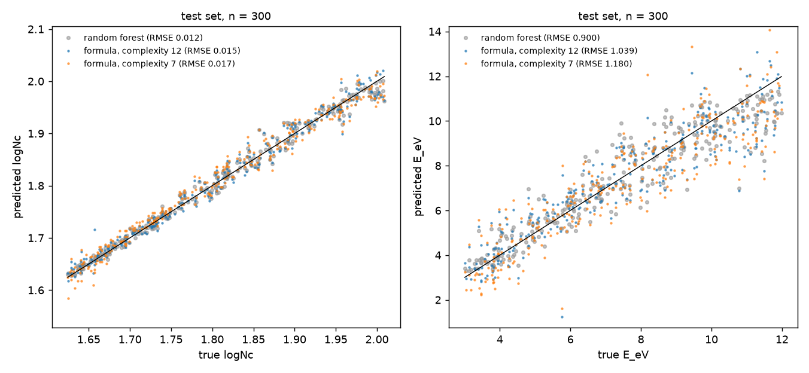
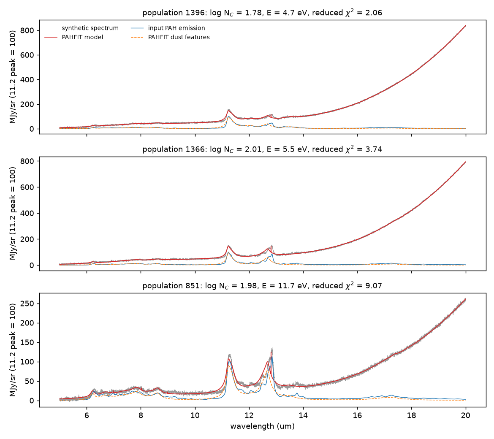
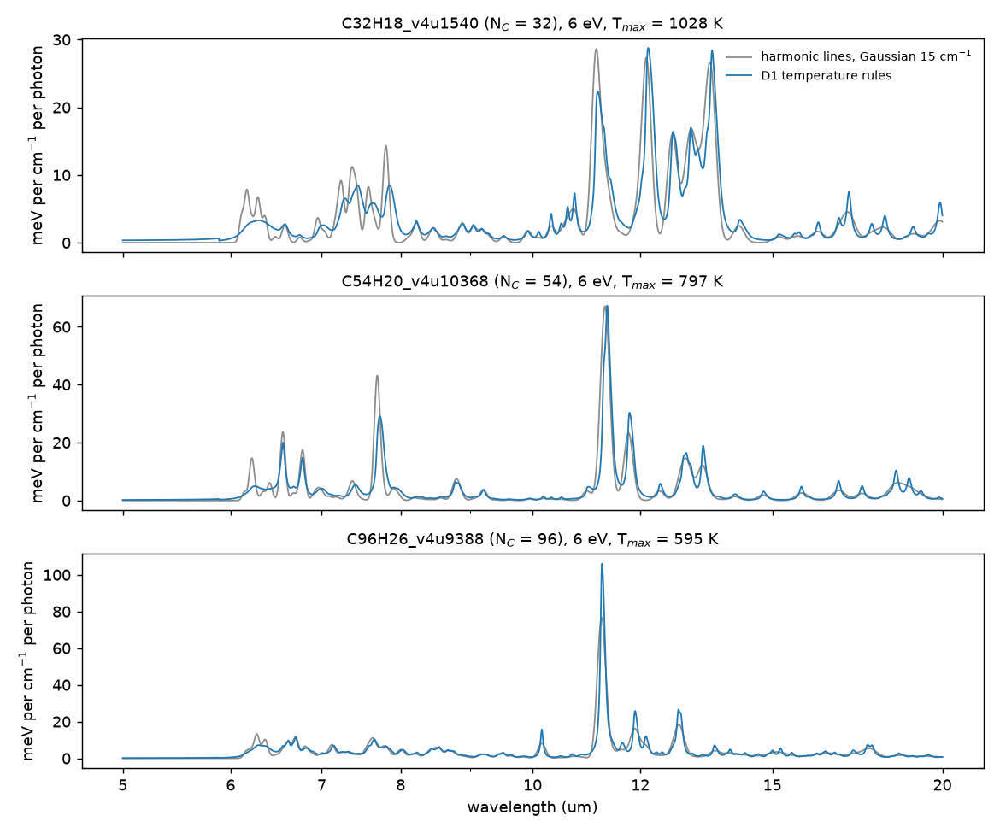

# Neutral symbolic-regression prototype, version 1 (2026-11-23)

The T0b pipeline run end to end on neutral PAHs only, so that cation libraries can be added as soon as the D1
dipole work delivers them. Requested by the coordinator (shared notes, 2026-11-23 21:06 KST). Run on `gh200` in
container C (`C_cpu.sif`, sha256 `5a0fd1b3…`; PAHFIT at commit `ca599f9a`, PySR 2.7.2, scikit-learn 1.9.1).

**Status: the pipeline works from species table to formula. The numbers are a neutral-only baseline, not
diagnostics to use.** The size formula it finds first reads edge structure, not size (section 4).

## 1. Input tables cleaned

**T0b slice pair replaced.** `slice/species.csv` pair 14 was C52H20 uid 10452 (cation 10480), which has no Kekulé
structure. `slice/select_species.py` now takes the spin screen as a third argument and leaves such species out.
The new pair 14 is C52H20 uid 10455 (cation 10445), also irregular; the other 24 pairs are unchanged.

**Spin screen of all of PAHdb v4.00** (`d1/screen_spin.py` → `d1/pahdb_v4_screen_spin_v1.csv`, 10,749 rows). It
extends `d1/kekule_check.py` to N-containing PAHs, ions and species with pentagons:
- It finds the smallest multiplicity the bonding allows: atoms that need a double bond are matched on the bond
  graph, in-ring N keeps a lone pair, and each unit of charge can absorb one unmatched atom.
- It compares that bound with the multiplicity PAHdb lists. `below_bound` means the listed state has fewer unpaired
  electrons than any Lewis structure allows.
- It is structure only. It cannot see open-shell singlets that do have a Kekulé structure, and 888 species with
  dehydrogenated carbons or metals are not screened.

| Group | Screened | Listed below the bound | What they are |
| --- | --- | --- | --- |
| C/H neutral | 3,091 | 351 | the 334 already known, 14 more singlets (odd carbon number, 13–59 C, uids 55–99), 3 doublets |
| C/H cation | 3,965 | 27 | 4 singlets (105–277 C), 21 doublets and 2 dications whose bound is higher |
| C/H anion | 745 | 2 | singlets |
| N-containing neutral | 518 | 52 | 30 singlets (C94H24N2, C52H18N2), 22 doublets (C93H24N3) |
| N-containing cation | 968 | 22 | singlets (C93H24N3⁺) |
| N-containing anion | 480 | 22 | singlets (C93H24N3⁻) |

- The screen reproduces all 334 species of `d1/pahdb_v4_exclude_nonkekule_v1.csv`.
- The 30 N-containing neutral singlets show the same intensity signature as the known error: total intensity per
  carbon 108 km/mol against 38 for consistent N-containing neutrals, CH-stretch share 0.08 against 0.22.
- For ions the signature does not separate (ions are intrinsically strong), so the ion flags rest on structure alone.
- 615 species are listed above the bound, almost all dication triplets. That is not an error by itself.
- No electron-count parity error anywhere. 12 species have no multiplicity listed.

**What was slated for use:**
- T0's 20 species and the other 49 slice species all pass.
- The D1 libraries (917 species at 300 K) hold 94 N-containing species. Of the 917, 184 are on the old exclusion
  list and 12 more fail the screen: C27H14 uid 69, C145H37 uid 6448, and 10 N-containing species (uids 7539, 7554,
  8415, 8430, 9227, 9230, 9238, 9245, 9249, 9262).
- A further 102 library species are open-shell neutrals that PAHdb computed consistently (94 doublets, 8
  triplets). They are left out of this prototype because the MLMD model behind the temperature rules is
  closed-shell; their PAHdb line lists are usable.

`tdep_rules_v1` was fitted with the 12 newly flagged species still in the libraries (4 of them in the 549 used for
the rules). Not rechecked; the effect on medians over 549 species should be small.

## 2. The pipeline

`slice/run_neutral.sh` (or `make -C slice neutral`) runs everything. Each stage is one script.

| Stage | Script | What it does |
| --- | --- | --- |
| Species | `neutral_pool.py` | 819 species: 619 PAHdb singlets from the 300 K library (41 with N) and our 200 high-spin recomputations (`d1/own_spectra/`). Nc 26–196. Every excluded species stays in `neutral_species_v1.csv` with its reason |
| Emission | `emission.py` | Thermal cascade per absorbed photon at 3–12 eV. `tdep`: every line shifted, scaled and broadened at each temperature step by `tdep_rules_v1` and `perline_widths_v2`, plus the 1700–2800 cm⁻¹ background. `harm`: fixed lines, Gaussian 15 cm⁻¹ (the PAHdb-style reference) |
| Populations | `populations.py` | 2,000 by Latin hypercube over mean size (log-normal, 0.2 dex) and photon energy. Structures of equal size get random shares. Absorption ∝ Nc |
| Instrument, bands | `measure.py` | MIRI MRS 5–20 µm on the Orion template grid thinned 4× (8,151 points), Orion-like continuum, S/N 50 at the 11.2 µm peak, PAHFIT `classic.yaml` with `maxiter=10000` |
| Regression | `regress.py` | Frozen feature schema, 70/15/15 split, random forest, isotonic one-ratio baselines, PySR (deterministic run twice, three seeds, shuffled labels), controls, Orion application |

Timing on gh200 with 56 workers: the whole chain took 21 minutes (1,282 s; `provenance.txt`). Emission 44 s,
populations 46 s, 2,000 PAHFIT fits 3 min (4.3 s each, all converged), one PySR run 30–55 s.

**To add cations:** append rows to the species table (same `structure_id`, `charge` 1) and give `emission.py` their
line lists. `populations.py` then draws the cation fraction f as a third axis and writes the emission-weighted
cation share; `regress.py` takes `--targets f_cation`. The analytic-endpoint control (plan 5.9, control 2) is not
written yet: it needs f.

**Differences from the plan (5.3–5.6):** the photon energy varies (3–12 eV) instead of being fixed at 6 eV, because
without charge it is the main nuisance for size; line profiles are Lorentzian with the D1 widths instead of a
15 cm⁻¹ Gaussian; the targets are size and photon energy instead of ionisation fraction.

## 3. Baseline results

Features are PAHFIT band strengths divided by the 11.2 µm complex: r62, r77, r86, r120, r127, r135, r170. The
11.2 µm band holds at least 15 % of the 5–20 µm emission in every population, so the ratios are valid everywhere.
All numbers are RMSE on the 300 test populations, scored once.

| Predictor | log₁₀ Nc (dex) | Photon energy (eV) |
| --- | --- | --- |
| Constant (training mean) | 0.114 | 2.60 |
| Best single ratio, isotonic (chosen on validation) | 0.022 (r120) | 2.19 (r77) |
| Random forest, 7 ratios | 0.012 | 0.90 |
| Random forest, noise-free window ratios of the input | 0.011 | 0.15 |
| PySR, complexity ≤ 7 | 0.017 | 1.18 |
| PySR, complexity ≤ 12 | 0.015 | 1.04 |
| Target set before the run | 0.05 | 1.5 |

Chosen on validation:
- **Size, complexity 7:** log₁₀ Nc = 1.739 + 0.341 (r127 − r120).
- **Size, complexity 12:** log₁₀ Nc = 1.108 + (√r127 + 0.861 + r170) / (r120 + 2.082).
- **Photon energy, complexity 7:** E = (r86 · ln r170 / 0.185)² eV.
- **Photon energy, complexity 12:** E = ((2 r86 + 0.201 r127) / (r170 + 0.0982))² eV.

The three seeded runs use multiprocessing and are not deterministic, so a rerun can choose a different member of
equal quality: an earlier run of the same data gave the same size formula but E = |r170 − r86| / 0.0151 (1.31 eV).

All four meet the plan's multi-ratio criterion (within 2× the forest, below the one-ratio baseline). The
deterministic PySR run reproduces exactly for both targets. The shuffled-label run does no better than the
constant (0.117 against 0.117 dex; 2.52 against 2.52 eV). Full fronts are in `front_*.csv`.

## 4. What the controls show

**The size formula measures edge structure, not size.** In the species pool, structure is tied to size: across
populations, the quartet-H share correlates with log Nc at −0.94 and the N-containing share at −0.98. A second
population set (`--tilt 2`) varies the trio + quartet share at fixed size:
- The version-1 formula's error rises from 0.017 to 0.075 dex, and its residual follows the tilt (r = +0.95).
- Retrained on the tilted set (`tilt/`), size: forest 0.022 dex, best single ratio 0.034 (r120), complexity 7 formula
  log₁₀ Nc = (6.85 − r135) / (r120 + 3.40) at 0.035, complexity 11 at 0.030. These pass the 0.05 target but are
  about 2× worse than version 1, and the complexity 7 formula is no better than the single ratio.
- Retrained on the tilted set, photon energy: forest 1.10 eV, complexity 7 formula (r86 − r170·r127) / 0.0194 at
  1.61 (misses the 1.5 target), complexity 12 at 1.42.
- Without the 12.0, 12.7 and 13.5 µm ratios the size forest reaches 0.028 (version 1) and 0.035 (tilted).
- Shuffled labels on the tilted set: 0.113 against 0.115 dex for the constant, and 2.38 against 2.47 eV. The
  second is 4 % below the constant on 300 rows; not repeated, so it may be chance.

This is the selection effect of Wang 2026 (Fig. 1), reproduced. The tilted set is the fairer baseline, and the
N-containing and own-spectrum shares are still tied to size in it (−0.83, −0.64).

**PAHFIT loses most of the photon-energy information.** From noise-free window integrals a forest reaches 0.15 eV;
from PAHFIT strengths 0.90 eV. The weak 6–9 µm bands of neutrals are the cause:

| Band / 11.2, PAHFIT model against input, same windows | 6.2 | 7.7 | 8.6 | 12.0 | 12.7 | 13.5 |
| --- | --- | --- | --- | --- | --- | --- |
| With continuum and noise (median) | 0.65 | 0.77 | 0.90 | 0.96 | 0.88 | 0.86 |
| 16–84 % range | 0.38–0.93 | 0.57–0.97 | 0.76–1.00 | 0.84–1.01 | 0.85–0.93 | 0.36–0.93 |
| No continuum, no noise (median) | 0.90 | 0.93 | 0.93 | 0.88 | 0.87 | 0.84 |

- With a continuum, PAHFIT gives a third of the 6.2 µm band to the continuum on average.
- Without continuum or noise, 71 of 300 fits settle in a wrong solution in which broad Drude wings stand in for a
  continuum and the 11.2 µm complex comes out 1.3× or more too strong. In the other 229, the median absolute
  recovery is 0.90–1.04 for every band.
- Median reduced χ² is 3.7: the Drude features do not match the library's band shapes. The library's 12.7 µm band
  peaks at 12.85 µm.

**Out-of-basis continuum (power law, 99 held-out populations).** Size is stable: forest 0.013 → 0.019 dex, formulas
unchanged. Photon energy fails: 0.94 → 2.9 eV for the forest and 1.2 → 3.4 eV for the formula, biased by −1.5 to
−2.0 eV. Its formulas lean on the 17 µm complex, which sits on the steep part of the continuum.

**Effect of the D1 temperature rules.** Predictors trained on `tdep` spectra and applied to `harm` spectra of the
same populations: the size forest goes from 0.013 to 0.040 dex (bias +0.016), the complexity 7 formula from 0.017
to 0.030 (bias +0.015); photon energy shifts by −0.4 to +0.6 eV, depending on the predictor. So the rules move the answer by about as much as
the formula's own error.

**Orion Bar templates.** All five lie far outside the neutral training domain: distance to the fifth nearest
training point 25–40 against a 99th-percentile threshold of 1.3. Their r62 is 0.9–1.5 and r77 2.8–4.6, where the
neutral library stops at 0.34 and 1.3. The predictions are extrapolations and are not reported as results. This
is what a neutral-only library should give for a region where cations dominate the 6–9 µm emission.

## 5. Problems found, to fix before the cation run

1. **Structure tied to size in the pool.** Make the structure mix a hypercube axis (the `--tilt` option is a first
   version) and balance N-containing and own-spectrum species across size.
2. **PySR crashes.** Julia segfaults at random inside SymbolicRegression (in constant optimisation and in the
   multiprocessing serializer), in serial and multiprocessing runs alike. In the final runs, photon-energy fits
   crashed in 17 of 28 attempts and size fits in 2 of 14. Crashed fits also leave Julia worker processes behind,
   which made the parent hang at exit. `regress.py` now runs every fit in its own process, retries up to 4 times,
   kills leftover workers and records the crash count (`pysr_log` in `results.json`). One fit failed all 4 tries:
   the repeat of the deterministic photon-energy run on the tilted set, so reproducibility is unchecked there. The
   cause is not known.
3. **Continuum.** The Orion-like continuum reaches about 2–9× the 11.2 µm peak at 20 µm (read off the fits), so the 17 µm complex is poorly
   constrained. The background rule's flat 1700–2800 cm⁻¹ component makes a small step at 5.88 µm.
4. **Rules outside their range.** Cascades reach 1,000–1,600 K for Nc < 40 at 6–12 eV; the rules are valid to
   900 K and are held constant above 1,200 K. Our 200 high-spin species and the 41 N-containing species have no
   MLMD spectra behind the rules either.
5. **Not done:** Monte Carlo refits of synthetic spectra (only the Orion templates have them, with an assumed 1 %
   uncertainty), the analytic-endpoint control, and a single HDF5 file with provenance (outputs are separate HDF5
   and CSV files; `provenance.txt` holds versions and hashes).

## Files here

`results.json` (all numbers), `provenance.txt`, `features.csv` (2,000 populations: labels, split, features), `pred_*.csv` (held-out
predictions), `front_*.csv` (Pareto fronts per PySR run), `figs/`. Intermediate files are on gh200 under
`/var/tmp/jjlee-pah/sr_proto/`: `out_e2e/` is the run reported here (`emission_v1.h5`, `pop_v1.h5`, `feat_*.csv`);
`out/` holds the tilted set (`pop_tilt.h5`, `feat_tilt_main.csv`, `reg_tilt/`), whose results are in `tilt/` here.
