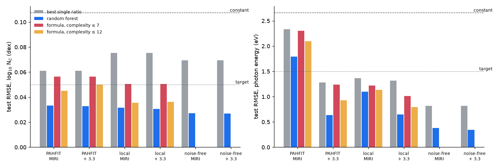
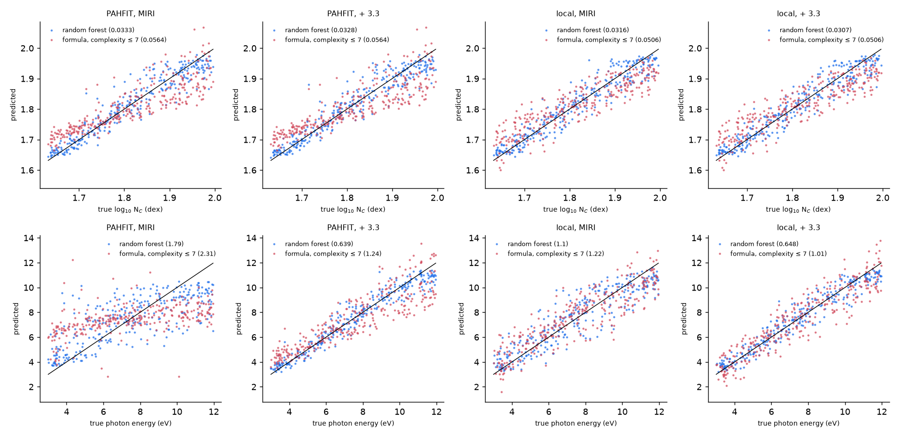

# Neutral symbolic-regression prototype, version 2 (2026-11-24)

Version 1 (`reports/neutral_sr_v1/`) ran the T0b chain on neutrals and found four problems. Version 2 fixes or
bounds each of them before cations are added. Requested by the coordinator (2026-11-24). Emission, populations and
PAHFIT ran on `gh200` in container C (`5a0fd1b3…`); the regression reported here ran on `z2mini` (x86-64, PySR 2.7.2,
Julia 1.13.4, scikit-learn 1.9.1), because PySR still crashes on gh200 (section 6).

**Status: v2 runs end to end with one command (`slice/run_neutral_v2.sh`). The numbers are a neutral-only baseline.**

| Question from version 1 | Answer in version 2 |
| --- | --- |
| Does size survive once edge structure is independent of size? | Yes, at 0.03 dex with a random forest (constant 0.108). Formulas reach 0.036–0.056 and still lean on the 12.7 and 13.5 µm bands |
| Does 3.3 µm add size information? | No: 0.033 → 0.033 dex. It adds photon energy: 1.1–1.8 eV → 0.65 eV |
| Was the 2.9 eV power-law failure a PAHFIT artefact? | Mostly a property of the v1 setup. In v2 an unseen continuum costs PAHFIT 14–27 % in photon energy and local integration nothing |
| Does the rule extrapolation above 900 K matter? | No for MIRI-only ratios (≤ 0.02 eV, ≤ 0.002 dex). With 3.3 µm, up to 0.1 eV (0.2 eV for small sizes) |
| Does the analytic-endpoint control pass? | Yes with local integration (f to 0.002–0.007 without noise). PAHFIT is non-linear at small sizes |
| Are the PySR crashes fixed? | Not on gh200 (9 of 57 fit attempts, thread settings applied). None in 48 fits on z2mini |

## 1. What changed

| Stage | Change | Script |
| --- | --- | --- |
| Emission | Three ways to extend the temperature rules above 900 K: held at 900 K (`tdep900`), linear to 1,200 K then held (`tdep`, as v1), linear without limit (`tdeplin`) | `emission.py --clamps` |
| Populations | Edge structure, N fraction, own fraction and the continuum are hypercube axes, independent of size (section 2) | `populations.py --design v2` |
| Measurement | Three continuum shapes (Orion-like, power law, one modified blackbody); a NIRSpec segment (2.95–3.85 µm, R = 2700); band integrals above a local continuum next to PAHFIT | `measure.py` |
| Regression | Observable sets side by side; residual-against-structure and per-continuum diagnostics | `regress_v2.py` |
| Endpoint control | Plan 5.9 control 2, on the 25 neutral/cation pairs of `slice/species.csv` | `endpoint.py` |

The pool is unchanged: 819 neutral species (`slice/neutral_species_v1.csv`), 2,000 populations, 70/15/15 split,
photon energy 3–12 eV. The control tables use the 600 validation + test populations. All 2,000 + 2,400 PAHFIT fits
converged (median reduced χ² 2.9).

## 2. Populations: structure no longer follows size

One tilt vector per population reweights species inside every size bin and class, so that the population's
emission-weighted shares of solo, trio and quartet H (Σ w N_C n_x / Σ w N_C n_H) hit targets drawn from the
hypercube. Bin weights (the log-normal size distribution) and the class shares (C/H, N-containing, own) are fixed
separately.

| Correlation with log N_C across populations | Version 1 | Version 2 |
| --- | --- | --- |
| Solo H share | — | +0.03 |
| Duo H share | — | −0.02 |
| Trio H share | — | 0.00 |
| Quartet H share | −0.94 | 0.00 |
| N-containing fraction | −0.98 | −0.13 |
| Own high-spin fraction | — | −0.02 |
| Photon energy | — | +0.04 |

- Targets are met to 0.001 (edge shares), 0.015 (N) and 0.004 (own). Ranges: solo 0.22–0.38, trio 0.08–0.28,
  quartet 0.03–0.10, N 0–0.12, own 0–0.20. A population holds 291 effective species (median; minimum 27).
- **Limit of the pool:** the targets hold for the population, not inside it. No pair of solo and trio targets can
  be met in every size bin (11 of 13 at best), and quartet H exists almost only below 37 C. So within a population
  small molecules still have different edges from large ones, and the per-molecule mean shares stay tied to size
  (solo +0.46, trio −0.27, quartet −0.23).
- The N fraction keeps −0.13 because N-containing species exist in only three size ranges (29–33, 52–58, 92–104 C).

## 3. Results

Test RMSE on 300 held-out populations (regression on z2mini). Observable sets: PAHFIT powers or local-continuum
integrals (spline), each over the 11.2 µm band, MIRI only or with the 3.3 µm band of the NIRSpec segment.

| Predictor | log₁₀ N_C (dex) | Photon energy (eV) |
| --- | --- | --- |
| Constant | 0.108 | 2.66 |
| **PAHFIT, MIRI:** single ratio / forest / formula ≤ 7 / ≤ 12 | 0.061 / 0.033 / 0.056 / 0.045 | 2.33 / 1.79 / 2.31 / 2.10 |
| **PAHFIT + 3.3 µm** | 0.061 / 0.033 / 0.056 / 0.050 | 1.28 / 0.64 / 1.24 / 0.93 |
| **Local, MIRI** | 0.075 / 0.032 / 0.051 / 0.036 | 1.37 / 1.10 / 1.22 / 1.13 |
| **Local + 3.3 µm** | 0.075 / 0.031 / 0.051 / 0.036 | 1.32 / 0.65 / 1.01 / 0.79 |
| Noise-free window integrals, MIRI / + 3.3 µm (forest) | 0.027 / 0.027 | 0.38 / 0.34 |
| Target set before the run | 0.05 | 1.5 |

Formulas chosen on validation (r = PAHFIT ratio, s = local ratio):
- **Size, local, ≤ 7:** log₁₀ N_C = 2.069 − s135 / (s135 + s127) (0.051 dex).
- **Size, local, ≤ 12:** log₁₀ N_C = 2.234 − s135 − 0.275 √s120 / (s127 + 0.130) (0.036).
- **Size, PAHFIT, ≤ 7:** log₁₀ N_C = √(r127 + 2.949) − r135² (0.056).
- **Photon energy, local + 3.3, ≤ 7:** E = 12.70 s62 + 3.44 s33 eV (1.01 eV).
- **Photon energy, local + 3.3, ≤ 12:** E = 10.25 s62 + s127 + s33 / √(s135 · s120) (0.79).
- **Photon energy, PAHFIT + 3.3, ≤ 7:** E = (r33 − r135) / 0.129 + 5.33 (1.24).

What the numbers say:
- **Size.** The forest keeps 0.03 dex, 3.5× better than the constant and close to the noise-free limit (0.027). The
  v1 value of 0.012 was the structure shortcut. Short formulas are at or above the 0.05 target; the local
  12-node formula passes.
- **Size still comes from the out-of-plane bands.** The forests put 0.6–0.7 of their weight on 12.7/11.2, and the
  size residual correlates with the trio share (forest +0.4 to +0.5; formulas up to +0.6) and the solo share
  (most formulas −0.2 to −0.6). The edge shares are independent of size across populations, so this is not the v1
  shortcut; it is the remaining coupling inside populations (section 2) plus a real sensitivity of those bands to
  structure. A change of edge structure at fixed size still moves the size estimate.
- **3.3 µm does not help size.** With the photon energy free (3–12 eV), 3.3/11.2 measures the peak temperature,
  which the forest uses for the photon energy (weight 0.5–0.8). The noise-free limit for size also does not move.
  A fixed or independently known radiation field would be needed for 3.3/11.2 to act as a size tracer; not tested.
- **Photon energy.** MIRI-only PAHFIT misses the 1.5 eV target (1.79); local integration reaches 1.10; with 3.3 µm
  both reach 0.65. A 5 % calibration error between NIRSpec and MIRI costs 0.02–0.03 eV.
- **PAHFIT against local integration.** Equal for size. For photon energy from MIRI alone, local integration is
  better (1.10 against 1.79 eV) because it keeps the 6.2 µm band (section 4).
- Deterministic PySR runs reproduce for all eight set–target pairs. Shuffled labels do no better than the constant
  (0.107–0.110 against 0.110 dex; 2.53 against 2.54 eV).

## 4. Controls

**Injection–recovery** (band/11.2 measured over true, median and 16–84 % range):

| Band | 3.3 | 6.2 | 7.7 | 8.6 | 12.0 | 12.7 | 13.5 | 17 |
| --- | --- | --- | --- | --- | --- | --- | --- | --- |
| PAHFIT, continuum + noise | — | 0.70 (0.48–0.92) | 0.75 (0.53–0.98) | 0.87 (0.69–1.04) | 0.92 | 0.91 | 0.87 | — |
| Local spline, continuum + noise | 0.98 (0.92–1.04) | 0.89 (0.78–1.00) | 0.82 (0.68–0.95) | 0.71 (0.57–0.85) | 0.96 | 0.93 | 0.76 | 0.51 |
| Local spline, clean | 1.01 | 0.91 (0.88–0.94) | 0.83 | 0.74 | 0.93 | 0.92 | 0.74 | 0.54 |
| PAHFIT, clean | — | 0.90 (0.45–0.95) | 0.92 (0.40–0.96) | 0.94 | 0.88 | 0.90 | 0.85 | — |

- Local integration loses a fixed share of the broad bands (8.6, 13.5, 17 µm) to the baseline, the same with and
  without a continuum. PAHFIT's loss at 6.2 and 7.7 µm depends on the continuum and scatters widely.
- PAHFIT's wrong continuum-free solution is still there (11.2 µm band up to 4.8× too strong at the 84th percentile).
- Straight-segment baselines are unusable for the 13.5 and 17 µm bands under a continuum (wide, sometimes negative).

**Unseen continuum** (forest trained on Orion-like continua only, tested per continuum type):

| Set | Target | Orion-like | Power law | Modified blackbody |
| --- | --- | --- | --- | --- |
| PAHFIT, MIRI | E (eV) | 1.80 | 2.05 (bias −0.44) | 2.28 (+0.20) |
| Local, MIRI | E (eV) | 1.31 | 1.32 (+0.30) | 0.98 (+0.14) |
| PAHFIT + 3.3 | E (eV) | 0.79 | 0.84 | 0.78 |
| Local + 3.3 | E (eV) | 0.79 | 0.82 | 0.69 |
| PAHFIT, MIRI | log N_C (dex) | 0.037 | 0.038 | 0.047 (+0.024) |
| Local, MIRI | log N_C (dex) | 0.039 | 0.032 | 0.036 |

- The v1 failure (0.9 → 2.9 eV) does not recur. Part of it was PAHFIT's basis (PAHFIT degrades by 14–27 % here,
  local integration does not), and part was v1's reliance on the 17 µm band under one continuum shape.
- Trained on all three shapes, the forests' errors differ between the three shapes by at most 30 %.

**Rule extrapolation above 900 K** (predictors trained on `tdep`, applied to the same 600 populations):

| Change | log N_C shift (dex) | E shift, MIRI only (eV) | E shift, with 3.3 µm (eV) |
| --- | --- | --- | --- |
| Held at 900 K | ≤ 0.002 | ≤ 0.02 (small sizes ≤ 0.04) | +0.06 to +0.12 (small sizes +0.11 to +0.23) |
| Linear without limit | ≤ 0.001 | ≤ 0.01 | −0.01 to −0.03 (small sizes −0.02 to −0.06) |

The choice is bounded at 0.2 eV and matters only for the 3.3 µm band of small molecules (centre below 50 C).

**Temperature rules against harmonic lines** (same test): size shifts by ≤ 0.03 dex, photon energy by +0.5 to +2.2
eV. In v2 the photon energy depends strongly on the anharmonic treatment; in v1 the shift was −0.4 to +0.6 eV.

**Analytic endpoints** (`endpoint.json`; three size distributions centred on 30, 50, 80 C at 6 eV; f = 0, 0.1, …, 1):

| Case | Method | f error, 6.2/11.2 (rms) | f error, 7.7/11.2 (rms) |
| --- | --- | --- | --- |
| Harmonic, clean | Local | 0.002–0.004 | 0.003–0.006 |
| Harmonic, clean | PAHFIT | 0.005–0.05 | 0.011–0.05 |
| Harmonic, continuum + noise | Local | 0.04 | 0.03–0.05 |
| Harmonic, continuum + noise | PAHFIT | 0.015–0.09 | 0.07–0.14 |

- The control passes with local integration: the ratio is monotone in f, the strengths are linear in f to 0.7 %,
  and f comes back. So charges, units and the cascade are wired correctly, and the cation path of
  `populations.py` (f axis, emission-weighted cation share) has now run.
- PAHFIT fails it at the smallest size: its 11.2 µm strength is off linear by 63 % there (the wrong solution), and
  6.2/11.2 is not monotone. With noise its 7.7/11.2 gives f to 0.07–0.14 only.
- 6.2/11.2 runs from 0.3 (neutral) to 2.6–4.6 (cation), so the Orion templates (0.9–1.5) fall inside a mixed range.
- With the temperature rules (fitted on neutrals) applied to cations the picture is the same (local, clean:
  0.002–0.007).

**Orion templates.** Still outside the neutral domain: distance to the fifth nearest training point 17–31 (PAHFIT
set) and 5–16 (local set) against thresholds of 2.2 and 2.1. No predictions reported.

## 5. `tdep_rules_v1` without flagged species

`tdep_rules_sensitivity.csv` (script next to it). Dropping the 4 newly flagged species among the 549 moves no rule by
more than 0.14 standard errors. But 137 of the 549 are on the old non-Kekulé list and 24 are doublets, outside the
closed-shell MLMD model. Dropping all 141 below-bound species moves a few rules by 2–4 standard errors and at most
0.2 of the scatter between species (7.7 µm strength −0.9 → −1.1 % per 100 K; 3.3 µm width at 300 K 21.5 → 22.2
cm⁻¹). No new table is issued here: the refit should be made on Hangang, where all 549 fits are (the local copy
reproduces v1 within 0.05 standard errors with 543 species).

## 6. Problems and what is left

1. **PySR on gh200.** With `JULIA_NUM_THREADS=1`, `OPENBLAS_NUM_THREADS=1`, `turbo=False`, `bumper=False` and process
   parallelism, Julia still segfaults (in the garbage collector's allocator, `jl_gc_small_alloc_inner`): 9 of 57
   fit attempts, all in serial deterministic runs (v1: 19 of 42). The gh200 run gives the same forests and formulas of
   the same quality (seeded runs differ, as expected). On z2mini the same 48 fits ran without a
   crash in 25–38 s each. `multithreading=False` is not a PySR 2.7 argument; `parallelism` covers it. **Run
   `regress_v2.py` on x86-64**: it needs only the feature tables (25 MB), `uv run --with pysr==2.7.2 --with
   scikit-learn==1.9.1`.
2. **Structure inside populations.** The pool cannot make edge structure independent of size inside a population
   (section 2). More small species without quartets and more large species with them are needed, or the size
   formula must be accepted as conditional on the pool's structure–size relation.
3. **Size and photon energy are degenerate in 3.3/11.2.** Test 3.3 µm as a size tracer at fixed photon energy
   before judging it.
4. **Rules.** Refit `tdep_rules_v1` without the 141 below-bound species (section 5).
5. **Not done:** Monte Carlo refits of synthetic spectra, single-HDF5 provenance, PAHdb-harmonic cations in the
   main run (the pair table `slice/pairs_species_v1.csv` would allow a first f target today).

## Files

`results.json` (every number above: `sets.<set>.targets.<target>`), `features.csv`, `pred_*.csv`, `front_*.csv`,
`endpoint.json`, `tdep_rules_sensitivity.csv`, `figs/`. Intermediate files: `gh200:/var/tmp/jjlee-pah/sr_proto/out_v2/`
(`emission_v2.h5`, `pop_v2.h5`, `feat_*.csv`, `pairs_*`; `reg_v2/` holds the gh200 regression run).
